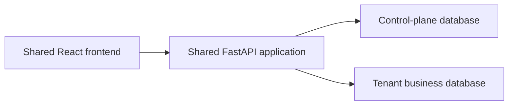

# ADR-001: Database-per-tenant multi-tenancy

- **Status:** Proposed — approved architectural direction, implementation not started
- **Date:** 2026-10-24

This record selects the isolation model for ACME HRMS V2. It does not implement that model.

## 1. Context

### Verified current behavior

The assessment application on `main` is a single shared database with one configured HR Manager.

- The UI is React and TypeScript (`frontend/`). The API is FastAPI (`backend/app/`). Persistence is PostgreSQL through SQLAlchemy. Schema changes are Alembic migrations under `backend/migrations/`.
- Business tables are `employees`, `salary_records`, and `salary_audit_logs`. `salary_records.employee_id` references `employees.id`. `salary_audit_logs.salary_record_id` references `salary_records.id`. Both foreign keys use `ON DELETE RESTRICT`.
- `employee_code` is unique across the whole `employees` table. Salary uniqueness is `(employee_id, effective_from)`.
- `user_sessions` stores a SHA-256 `token_hash`, `expires_at`, and `revoked_at`. It has no user id and no tenant id. Login checks `HR_MANAGER_USERNAME` and `HR_MANAGER_PASSWORD_HASH` from environment settings. Audit `changed_by` is the configured string `HR_MANAGER_IDENTITY`, not a user row.
- There is no tenant registry, no database-per-tenant routing, and no database-backed user or membership table. Any valid session can read and write every employee, salary, audit row, and analytics result. Queries in the employee, salary, and analytics services are unscoped.
- Alembic head is `0004_create_user_sessions`. `get_db` commits on success and rolls back on exception. Pytest derives database name `acme_test` and refuses to migrate any other name. The development seed (`backend/scripts/seed_dev_data.py`) writes only a database named `acme_salary` and refuses `acme_test`. It skips employee codes that already exist.
- `compose.yaml` runs one application container and one PostgreSQL service. It does not migrate or seed on startup.

### Target design (not implemented)

V2 keeps one shared application and gives each company its own PostgreSQL database for business data. A separate control-plane database holds registry, identity, membership, and routing metadata. The current models and login settings stay as they are until a later change on `develop/hrms-v2`.

## 2. Decisions

These are agreed directions, not current code.

1. One tenant is one company or organization.
2. Each tenant has a separate PostgreSQL database for its business data.
3. The application is shared. The default is not a separate application deployment per company.
4. A company may have multiple users.
5. Initially, each user belongs to one company. Membership is modeled so a later version can allow one person in more than one company without treating that as the first release.
6. Employee, salary, salary-audit, and later HR business records live in that tenant’s database.
7. A control-plane database stores the tenant registry, identity and membership data, database routing metadata, and provisioning status.
8. The server resolves the tenant and database from the authenticated identity and an authorized membership. A client-supplied tenant id or database name is never authorization.
9. Roles and permissions decide what a user may do inside their company. A separate database does not replace those checks.
10. `main` stays the assessment baseline. V2 work happens on `develop/hrms-v2` and feature branches. V2 feature merges do not land on `main`.

## 3. High-level architecture

1. The shared React app calls the shared FastAPI app on the same origin as today.
2. The API authenticates the caller and checks authorization.
3. Control-plane data identifies the user, their company membership, and whether that tenant is ready.
4. The server selects the tenant database from that trusted state.
5. The business request uses a session connected only to that tenant database.
6. That database holds the employee, salary, and salary-audit domain, plus later HR tables.

## 4. Control-plane responsibilities

The control plane is the registry, not a second copy of HR records.

It should hold:

- Tenant identity and status.
- User identity records.
- Membership of a user in a company, including the initial single-company rule.
- Routing metadata: which database serves that tenant, and a reference to credentials.
- Provisioning state and the schema version last applied to that tenant database.

Database passwords must not be stored in plaintext in the control plane or in git. Prefer a secret-manager reference or protected deployment configuration. Employee, salary, and audit rows stay in the tenant database.

## 5. Tenant database provisioning lifecycle

Proposed states, not implemented:

| State | Meaning |
|---|---|
| Requested | A company has been accepted for creation. No tenant database is in service. |
| Provisioning | The database is being created and credentials are being stored as secret references. |
| Migrating | Versioned Alembic migrations are being applied to that database. |
| Ready | Migrations succeeded and the first company administrator exists. The API may route business traffic here. |
| Failed | Creation, migration, or admin bootstrap did not finish. The tenant is not routable. |
| Suspended | The tenant existed but business traffic must stop until an operator clears the status. |

Safe sequence for a later implementation:

1. Record Requested in the control plane.
2. Create an empty database with a least-privilege role. Move to Provisioning.
3. Apply the tenant schema migrations. Move to Migrating. Record the target revision.
4. Create the first company administrator in the control plane and bind them to this tenant.
5. Mark Ready only after those steps succeed.
6. On failure, mark Failed, store the error, and leave the tenant unroutable.
7. Retry starts from the last successful step. Do not create a second database for the same tenant if one already exists.
8. If a partial database was created and provisioning will not be retried, drop or quarantine that database only through an explicit compensation step recorded in the control plane.

Provisioning is not part of application startup and is not part of this ADR’s implementation.

## 6. Authentication and authorization

**Verified today:** one environment username and Argon2 hash; opaque hashed sessions; CSRF cookie plus `X-CSRF-Token` on state-changing routes; trusted-origin check on login; no user table.

**Proposed:** replace that single identity with database-backed users in the control plane.

- Store password hashes, not plaintext passwords. Keep a slow hash such as Argon2id.
- Sessions remain server-side and revocable, with an expiry. A session is bound to a user and, for this first model, to that user’s one company.
- Keep CSRF on browser state-changing requests. Login still needs an origin check because it has no session yet.
- After authentication, authorize the action with a role and permission check for that company. Isolation of the database is not that check.
- The control plane is authoritative for user status, company membership, and tenant status. Before any business-data access, the server must confirm that the authenticated user is still active, that their membership in the resolved company is still active, and that the tenant is Ready. A cookie or cached session is not enough if those control-plane facts have changed.
- Deactivation and session revocation must apply to existing sessions, not only to the next login. A revoked or deactivated user is rejected on the next request that would use that session.
- A tenant in Failed, Suspended, or any state other than Ready cannot receive business traffic. Fail closed.
- These checks are proposed. They are not implemented. Do not invent this user model as if it already exists. `user_sessions` today has no user foreign key.

## 7. Database routing and security

For a business request the application must:

1. Authenticate the user.
2. Resolve the authorized company from server-side session and membership state.
3. Load that tenant’s routing record from the control plane.
4. Open a connection or session only for that tenant database.
5. Ignore any client-supplied tenant id or database name as a routing authority.
6. Never reuse a business session across tenants. A request that finishes or fails must not leave a connection checked out for another company.
7. Fail closed when the tenant is missing, not Ready, or Suspended.
8. Restrict registry and provisioning operations to an elevated operator permission, separate from company HR roles.
9. Use tenant-specific database credentials, or another least-privilege mechanism, where the host allows it. Ordinary business requests must not connect as a PostgreSQL superuser. Runtime privileges for application queries should be separate from provisioning and migration privileges where practical: the request path needs only the rights to read and write that tenant’s business schema, while creating databases and applying migrations uses a different, narrower-use credential.
10. Store those credentials securely. Do not put passwords in the frontend, in source control, or in application logs.
11. Test routing and authorization failures, not only the success path.

Connection pools are part of the same routing rules. None of this pooling behavior exists today.

- A business database session is bound to the tenant database selected for that request.
- A pool is not shared across different tenant database configurations. A connection opened for one company is not checked out for another.
- Pool size per tenant and the process-wide connection count are bounded so one tenant or a large tenant set cannot exhaust PostgreSQL.
- Idle pools and pools for Suspended, Failed, or removed tenants are closed safely, without handing a leftover connection to a later request.

## 8. Tenant schema and migrations

Each tenant database starts from the same versioned schema. Schema changes are written once and applied per tenant database by a controlled rollout. One Alembic command against one URL does not update every tenant.

Track, per tenant, the revision applied, the time, and success or failure. A failed tenant stays off Ready until a retry succeeds. Retries must be safe against a partially applied migration.

Compatibility: application code that talks to tenant databases must tolerate the revisions it is allowed to serve, or the rollout must stop traffic to tenants still on the previous revision. Back up a tenant database before a destructive migration. PostgreSQL downgrades are not automatic; rollback is restore or a forward fix, not an assumed Alembic downgrade across every tenant.

## 9. Existing data migration

The assessment database holds employees, salaries, audit rows, and sessions. This is a plan, not a migration to run now.

1. Leave `main` and the current assessment database unchanged until a rehearsed cutover on a disposable copy.
2. Choose one default tenant as the owner of the existing business rows.
3. Create that tenant database and apply the tenant schema.
4. Copy employees, salary records, and salary audit logs. Preserve primary keys and foreign keys so salary history and audit history still match.
5. Decide explicitly whether existing `user_sessions` rows are discarded. Recommendation: invalidate them. They are not tied to a user or tenant, and copying them would keep the single shared login behavior.
6. Compare row counts, foreign-key integrity, and a small set of API reads against the source.
7. Take a verified backup and rehearse on a disposable database first.
8. Keep the source data until that validation succeeds. Do not truncate the assessment database as part of writing this ADR.

## 10. Seed data and development

Recommendation:

- Development seed data is not production data. The existing `--count 10000` generator stays a development dataset for the default development tenant unless a later decision says otherwise.
- A tenant-aware seed must receive an explicit tenant database target that has already passed the same name and host checks used to refuse `acme_test`. It must not scan or write every tenant database.
- Preserve the pytest rule: automated tests migrate and write `acme_test` only, derived from `DATABASE_URL` by changing the database name. Do not point tests at `acme_salary`, Compose data, or a tenant database used for manual development.
- Seed and tests must fail closed when the target host or database name is missing, unexpected, or equal to a configured production URL.

## 11. Consequences and trade-offs

**Benefits**

- Business rows for two companies are not in the same tables, so a missing `tenant_id` predicate cannot leak rows.
- Backup and restore can be per company.
- A noisy tenant can later be moved to its own instance without changing the application boundary.
- Cross-tenant query bugs are harder to introduce than in a shared table.

**Costs**

- Someone must provision, migrate, monitor, back up, and retire many databases.
- Schema rollout is N migrations, not one.
- Connection counts and pools grow with active tenants and need limits.
- Cross-tenant reporting is a separate design. It must not query tenant databases with an HR user’s session.
- A separate database is not a complete security boundary. Misrouted credentials, a shared superuser, a bug in routing, or an operator action can still cross tenants.

Smaller per-tenant tables can help some queries. Performance still depends on indexes, plans, and the actual workload. This ADR does not claim a speedup.

## 12. Testing and acceptance criteria

Later implementation should include tests that:

- Select the correct tenant database for each authenticated user.
- Reject a client-supplied tenant id or database name that does not match the session’s membership.
- Deny Suspended, Failed, and not-Ready tenants.
- Do not reuse a session or connection across two tenants in one request flow.
- Allow more than one user in the same company, with the same business data.
- Enforce role and permission checks inside that company.
- Cover provisioning success and a partial failure that can be retried without a second live database.
- Record schema version per tenant and detect a migration failure.
- Preserve employee, salary, and audit row counts and foreign keys in the rehearsed data copy.
- Keep the existing employee, salary, audit, analytics, and authentication regression tests.
- Write automated tests only to the isolated test database, never to development or production data.

## 13. Alternatives considered

**Shared database with `tenant_id` on each business row.** Simpler operations and one migration. Weaker isolation: every query must include the tenant predicate, and a missing filter leaks data. Rejected as the primary model because the product direction prioritizes stronger separation. It remains a possible optimization for a future low-sensitivity store, not for salary and audit data.

**Schema-per-tenant in one PostgreSQL instance.** Fewer servers than database-per-tenant, but shared roles, extensions, and backup granularity are coarser, and search path mistakes mix tenants. Rejected as the default.

**One deployed application per tenant.** Strong isolation and independent releases. High cost and operational load for every company. Rejected as the default. A later enterprise customer may still receive a dedicated PostgreSQL instance behind the same application code. That is an unresolved hosting choice, not a separate codebase per company.

**Selected direction:** one shared FastAPI and React application, one control-plane database, and one PostgreSQL database per tenant for business data.

## 14. Unresolved decisions

- How tenant PostgreSQL instances are hosted, and the database naming convention.
- Where credentials live, how they are injected, and how they rotate.
- Whether user identity rows exist only in the control plane, with no user table in the tenant database.
- The initial role and permission matrix.
- The exact onboarding flow that creates the first company administrator.
- Deletion, retention, suspension, and offboarding of a tenant and its database.
- Connection pool size, idle eviction, and what happens when a tenant database is suspended or dropped.
- Order of migration rollout, who can retry, and how a bad revision is recovered.
- Backup, restore, disaster recovery, and the metrics that show a tenant is Ready or Failed.
- Whether a future enterprise tenant gets a dedicated PostgreSQL instance.
- How cross-tenant or platform analytics run without exposing another company’s business rows to an HR user.

## 15. Implementation sequence

1. Accept this ADR.
2. Design the control-plane schema.
3. Design the tenant schema and the provisioning contract.
4. Implement on a feature branch from `develop/hrms-v2`.
5. Add authentication, membership, and tenant database routing.
6. Rehearse the copy of existing employees, salaries, and audit rows onto a disposable tenant database.
7. Run isolation tests and the existing regression tests against the isolated test database.
8. Review and merge into `develop/hrms-v2` only. Do not merge this work into `main`.

This ADR records the architectural direction only. No application code, database schema, migration, or tenant provisioning has been changed.
