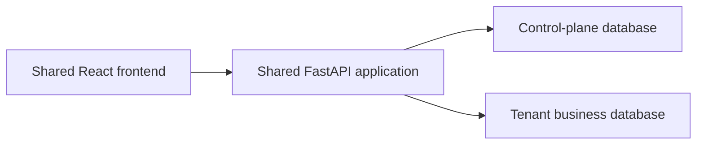

# ADR-001: Database-per-tenant multi-tenancy

- **Status:** Proposed — approved architectural direction, implementation not started
- **Date:** 2026-10-24

This record selects the isolation model for ACME HRMS V2. It does not implement that model.

## 1. Context

### Verified current behavior

The assessment application on `main` is a single shared database with one configured HR Manager.

- The UI is React and TypeScript (`frontend/`). The API is FastAPI (`backend/app/`). Persistence is PostgreSQL through SQLAlchemy. Schema changes are Alembic migrations under `backend/migrations/`.
- Business tables are `employees`, `salary_records`, and `salary_audit_logs`. `salary_records.employee_id` references `employees.id`. `salary_audit_logs.salary_record_id` references `salary_records.id`. Both foreign keys use `ON DELETE RESTRICT`.
- `employee_code` is unique across the whole `employees` table. Salary uniqueness is `(employee_id, effective_from)`.
- `user_sessions` stores a SHA-256 `token_hash`, `expires_at`, and `revoked_at`. It has no user id and no tenant id. Login checks `HR_MANAGER_USERNAME` and `HR_MANAGER_PASSWORD_HASH` from environment settings. Audit `changed_by` is the configured string `HR_MANAGER_IDENTITY`, not a user row.
- There is no tenant registry, no database-per-tenant routing, and no database-backed user or membership table. Any valid session can read and write every employee, salary, audit row, and analytics result. Queries in the employee, salary, and analytics services are unscoped.
- Alembic head is `0004_create_user_sessions`. `get_db` commits on success and rolls back on exception. Pytest derives database name `acme_test` and refuses to migrate any other name. The development seed (`backend/scripts/seed_dev_data.py`) writes only a database named `acme_salary` and refuses `acme_test`. It skips employee codes that already exist.
- `compose.yaml` runs one application container and one PostgreSQL service. It does not migrate or seed on startup.

### Target design (not implemented)

V2 keeps one shared application and gives each company its own PostgreSQL database for business data, company user accounts, password hashes, and refresh-session records. A separate control-plane database holds the tenant registry, routing metadata, provisioning lifecycle, company access status, and platform-level operations. It does not hold company users, company memberships, company password hashes, or company refresh sessions. Employee status stays in the tenant database. The current models and login settings stay as they are until a later change on `develop/hrms-v2`.

## 2. Decisions

These are agreed directions, not current code.

1. One tenant is one company or organization.
2. Each tenant has a separate PostgreSQL database for its business data.
3. The application is shared. The default is not a separate application deployment per company.
4. A company may have multiple users.
5. A company user account lives in that company’s tenant database. There is no control-plane company membership and no company-selection login.
6. Employee, salary, salary-audit, and later HR business records live in that tenant’s database. Company user accounts, employee IDs, password hashes, and refresh-session records live there too. An employee ID is unique within its tenant. It does not have to be unique across companies.
7. A control-plane database stores the tenant registry, database routing metadata, provisioning status, company access status, and platform-level operations. It does not store company users, company memberships, company password hashes, or company refresh sessions.
8. A company-specific login URL identifies the tenant to resolve. There is no public company directory. The URL is not authorization. The authenticated identity, the token’s tenant binding, the resolved tenant, and the selected tenant database must agree. A client-supplied tenant id or database name is never authorization.
9. Roles and permissions decide what a user may do inside their company. A separate database does not replace those checks.
10. `main` stays the assessment baseline. V2 work happens on `develop/hrms-v2` and feature branches. V2 feature merges do not land on `main`.
11. Company login uses the company-assigned employee ID and password.
12. Access tokens are JWTs with a 15-minute lifetime. Refresh tokens are opaque random tokens with a 7-day lifetime. Access and refresh tokens use HttpOnly cookies.
13. Persist only refresh-token hashes, and persist them in the relevant tenant database. Refresh-token rotation and reuse detection are required. The refresh-session table is part of the tenant schema design, not this ADR.
14. The first company administrator is created in the tenant database. Do not add a cross-database foreign key to that user.
15. Company access status is managed in the control plane. The initial values are `Active` and `Deactivated`. This status is separate from the provisioning lifecycle in section 5. A deactivated company cannot call normal HRMS business APIs, even when an employee presents an unexpired JWT. Company deactivation overrides any employee document-retrieval grace period.
16. Employee status is managed in the tenant database. The initial values are `Active` and `Deactivated`. An employee’s access must respect both the current company access status and the current employee status.
17. Each company chooses its own employee deactivation policy. The initial choices are immediate access revocation, or a 12-hour document-only retrieval grace period. The grace period is not a platform-wide policy. During a valid grace period the employee may access only explicitly permitted personal documents, such as eligible payslips and employment documents. The grace period does not allow normal HR operations, editing employee records, or viewing other employees’ information. When the grace period ends, document access is denied.
18. The backend records the employee’s deactivation time with server-side time and persists it. Grace-period eligibility and expiry use that timestamp and the company’s selected policy. Browser clocks and JWT expiry do not set the deadline. Persisted state must survive application restarts. This ADR does not require a separate `grace_until` column and does not design the tenant schema.
19. A valid JWT alone does not establish that the company or the employee is still active. A protected request enforces the current company access status, the current employee status, the applicable authorization permissions, and any still-valid document-only grace period. Tenant isolation and fail-closed provisioning behavior remain in force. The 15-minute access-token lifetime and the 7-day refresh-token lifetime are unchanged. Neither lifetime extends a grace deadline or overrides company deactivation.

## 3. High-level architecture

1. The shared React app calls the shared FastAPI app on the same origin as today.
2. A company-specific login URL identifies which tenant registry row to resolve. There is no public company directory and no company-selection login. The URL is not authorization.
3. The API authenticates the company user in that tenant’s database and checks authorization.
4. Control-plane data says whether that tenant is ready, whether the company’s access status is `Active` or `Deactivated`, and which database serves it. It does not supply the company user, password hash, refresh session, or employee status.
5. The server selects the tenant database only when the authenticated identity, the token’s tenant binding, the resolved tenant, and that database agree.
6. The business request uses a database connection only to that tenant database.
7. That database holds the employee, salary, and salary-audit domain, later HR tables, and that company’s user accounts, password hashes, and refresh-session records.

## 4. Control-plane responsibilities

The control plane is the registry and routing record, not a copy of company accounts or HR records.

It should hold:

- Tenant identity, provisioning status, and company access status (`Active` or `Deactivated`).
- Routing metadata: which database serves that tenant, and a reference to database credentials.
- Provisioning state and the schema version last applied to that tenant database.
- Platform-level operation state. Platform-operator authentication is separate from company login and is not specified here.

It should not hold:

- Company user accounts.
- Company memberships.
- Company password hashes.
- Company refresh sessions.
- Employee, salary, or salary-audit rows.

PostgreSQL passwords must not be stored in plaintext in the control plane or in git. Prefer a secret-manager reference or protected deployment configuration. Company password hashes stay in the tenant database with the other company account data.

## 5. Tenant database provisioning lifecycle

Proposed states, not implemented:

| State | Meaning |
|---|---|
| Requested | A company has been accepted for creation. No tenant database is in service. |
| Provisioning | The database is being created and credentials are being stored as secret references. |
| Migrating | Versioned Alembic migrations are being applied to that database. |
| Ready | Migrations succeeded and the first company administrator exists. The database may be routed. Normal HRMS business API access also requires company access status `Active` and the other applicable authorization checks. |
| Failed | Creation, migration, or admin bootstrap did not finish. The tenant is not routable. |
| Suspended | The tenant existed but business traffic must stop until an operator clears the status. |

Safe sequence for a later implementation:

1. Record Requested in the control plane.
2. Create an empty database with a least-privilege role. Move to Provisioning.
3. Apply the tenant schema migrations. Move to Migrating. Record the target revision.
4. Create the first company administrator in the tenant database. Do not store that account in the control plane, and do not add a cross-database foreign key to it.
5. Mark Ready only after migration has succeeded and that administrator exists.
6. On failure, mark Failed, store the error, and leave the tenant unroutable.
7. Retry starts from the last successful step. Do not create a second database for the same tenant if one already exists.
8. If a partial database was created and provisioning will not be retried, drop or quarantine that database only through an explicit compensation step recorded in the control plane.

Provisioning is not part of application startup and is not part of this ADR’s implementation.

Company access status is not one of the provisioning states above. Provisioning lifecycle transitions do not implicitly activate or deactivate the company. That includes marking a tenant `Ready` or `Failed`, marking it `Suspended`, and recovering it through retry or compensation. `Ready`, `Failed`, and `Suspended` remain the provisioning and routing lifecycle. `Active` and `Deactivated` remain company access authorization. This ADR does not choose the company’s initial access status, an automatic transition into either access value, or who may change that status. A tenant can be `Ready` and still be `Deactivated`. `Ready` means the database may be routed. `Active` means the company may use normal HRMS business APIs. `Failed`, `Suspended`, and any provisioning state other than `Ready` remain fail-closed: that tenant receives no business traffic, including document-grace traffic, and other tenants stay unaffected. Company `Deactivated` also denies normal business APIs and denies document grace, including when a JWT has not yet expired.

## 6. Authentication and authorization

**Verified today:** one environment username and Argon2 hash; opaque hashed sessions; CSRF cookie plus `X-CSRF-Token` on state-changing routes; trusted-origin check on login; no user table. `user_sessions` has no user foreign key. That table is not the V2 refresh-session store.

**Agreed direction, not implemented:** company accounts live in the tenant database named by decisions 5, 6, 11, 12, 13, and 14.

- Store password hashes, not plaintext passwords, in the tenant database. Keep a slow hash such as Argon2id.
- Login resolves the tenant from the company-specific URL, then checks the company-assigned employee ID and password in that tenant database.
- The access token is a JWT lasting 15 minutes. The refresh token is an opaque random token lasting 7 days. Both are HttpOnly cookies. Persist only the refresh-token hash, in that tenant database. Do not persist the access JWT or the raw refresh token.
- Rotation and reuse detection are required. This ADR does not define the reuse response, token-family revocation, or concurrent refresh behavior.
- The authenticated identity, token tenant binding, resolved tenant, and selected tenant database must agree. Fail closed when they do not.
- After authentication, authorize the action with a role and permission check for that company. Isolation of the database is not that check.
- The control plane is authoritative for provisioning status and for company access status (`Active` or `Deactivated`). The tenant database is authoritative for employee status (`Active` or `Deactivated`) and for the persisted server-side deactivation time. A tenant in Failed, Suspended, or any provisioning state other than Ready cannot receive business traffic. Fail closed. One tenant’s Failed, Suspended, or Deactivated status stops that tenant’s business traffic and does not by itself take another tenant’s database offline.
- A protected request checks the current company access status, the current employee status, the applicable permissions, and any document-only grace period that is still valid under decisions 15–19. A cryptographically valid JWT, including one inside its 15-minute lifetime, is not sufficient. Refreshing a token does not move the grace deadline and does not restore a deactivated company.
- When the company’s employee policy is immediate revocation, a deactivated employee loses normal HRMS access and document access. When the company’s policy is the 12-hour grace period, and the company remains `Active` and the tenant remains `Ready`, that employee may retrieve only explicitly permitted personal documents until 12 hours after the persisted server-side deactivation time. The backend decides expiry from that timestamp and the company policy. It does not use the browser clock or the JWT `exp` claim. After those 12 hours, document access is denied.
- Company `Deactivated` overrides the employee grace period. A deactivated company denies normal HRMS business APIs and document retrieval, even if an employee’s own grace window has not elapsed and even if the JWT or refresh token has not expired.
- Logout’s effect on an already-issued JWT remains unresolved. The mechanism that makes a JWT unusable as a credential, such as a denylist or a token version, also remains unresolved. Those open mechanics do not weaken the authorization checks above.
- Login still needs an origin check because it has no token yet. CSRF protection for later cookie-authenticated requests, cookie names, and `Secure`, `SameSite`, `Path`, and `Domain` are unresolved.
- Platform-operator authentication is separate from company login. This ADR does not specify it.
- JWT claims, signing-key management, further token-validation details, and whether a user may hold multiple refresh sessions at once are unresolved.

## 7. Database routing and security

For a business request the application must:

1. Resolve the tenant from the company-specific login URL. Do not offer a public company directory or a company-selection login.
2. Authenticate the company user in that tenant database, by employee ID and password at login, or by the access or refresh token on a later request.
3. Load that tenant’s routing record from the control plane. Do not load a company user or refresh session from the control plane.
4. Open a connection only for that tenant database, and only when the authenticated identity, the token’s tenant binding, the resolved tenant, and the selected database agree.
5. Ignore any client-supplied tenant id or database name as authorization. The login URL selects the registry row and is not itself authorization.
6. Never reuse a company token or a business database connection across tenants. A request that finishes or fails must not leave a connection checked out for another company.
7. Fail closed when the tenant is missing, not Ready, or Suspended, and when company access status is `Deactivated`. A deactivated company is denied normal HRMS business APIs and denied document grace. A document-only request is allowed only when the tenant is Ready, the company is `Active`, the employee is `Deactivated`, the company selected the 12-hour policy, server time is still inside 12 hours of the persisted deactivation timestamp, and the request is limited to that employee’s explicitly permitted personal documents. That closure applies to the affected tenant and does not require stopping other tenants.
8. Restrict registry and provisioning operations to an elevated operator permission, separate from company roles. Do not treat company login as that operator path. Operator authentication is not specified here. Whether a change to company access status is one of those registry or provisioning operations remains unresolved. This item does not choose who may activate or deactivate a company.
9. Use tenant-specific database credentials, or another least-privilege mechanism, where the host allows it. Ordinary business requests must not connect as a PostgreSQL superuser. Runtime privileges for application queries should be separate from provisioning and migration privileges where practical: the request path needs only the rights to read and write that tenant’s business schema, while creating databases and applying migrations uses a different, narrower-use credential.
10. Store those credentials securely. Do not put passwords in the frontend, in source control, or in application logs.
11. Test routing and authorization failures, not only the success path.

Connection pools are part of the same routing rules. None of this pooling behavior exists today.

- A business database session is bound to the tenant database selected for that request.
- A pool is not shared across different tenant database configurations. A connection opened for one company is not checked out for another.
- Pool size per tenant and the process-wide connection count are bounded so one tenant or a large tenant set cannot exhaust PostgreSQL.
- Idle pools and pools for Suspended, Failed, or removed tenants are closed safely, without handing a leftover connection to a later request.

## 8. Tenant schema and migrations

Each tenant database starts from the same versioned schema. Schema changes are written once and applied per tenant database by a controlled rollout. One Alembic command against one URL does not update every tenant.

Track, per tenant, the revision applied, the time, and success or failure. A failed tenant stays off Ready until a retry succeeds. Retries must be safe against a partially applied migration.

Compatibility: application code that talks to tenant databases must tolerate the revisions it is allowed to serve, or the rollout must stop traffic to tenants still on the previous revision. Back up a tenant database before a destructive migration. PostgreSQL downgrades are not automatic; rollback is restore or a forward fix, not an assumed Alembic downgrade across every tenant.

## 9. Existing data migration

The assessment database holds employees, salaries, audit rows, and sessions. This is a plan, not a migration to run now.

1. Leave `main` and the current assessment database unchanged until a rehearsed cutover on a disposable copy.
2. Choose one default tenant as the owner of the existing business rows.
3. Create that tenant database and apply the tenant schema.
4. Copy employees, salary records, and salary audit logs. Preserve primary keys and foreign keys so salary history and audit history still match.
5. Do not copy existing `user_sessions` rows into tenant refresh-session records. Invalidate them. They are not tied to a user or tenant, and copying them would keep the single shared login behavior.
6. Compare row counts, foreign-key integrity, and a small set of API reads against the source.
7. Take a verified backup and rehearse on a disposable database first.
8. Keep the source data until that validation succeeds. Do not truncate the assessment database as part of writing this ADR.

## 10. Seed data and development

Recommendation:

- Development seed data is not production data. The existing `--count 10000` generator stays a development dataset for the default development tenant unless a later decision says otherwise.
- A tenant-aware seed must receive an explicit tenant database target that has already passed the same name and host checks used to refuse `acme_test`. It must not scan or write every tenant database.
- Preserve the pytest rule: automated tests migrate and write `acme_test` only, derived from `DATABASE_URL` by changing the database name. Do not point tests at `acme_salary`, Compose data, or a tenant database used for manual development.
- Seed and tests must fail closed when the target host or database name is missing, unexpected, or equal to a configured production URL.

## 11. Consequences and trade-offs

**Benefits**

- Business rows for two companies are not in the same tables, so a missing `tenant_id` predicate cannot leak rows.
- Backup and restore can be per company.
- A noisy tenant can later be moved to its own instance without changing the application boundary.
- Cross-tenant query bugs are harder to introduce than in a shared table.

**Costs**

- Someone must provision, migrate, monitor, back up, and retire many databases.
- Schema rollout is N migrations, not one.
- Connection counts and pools grow with active tenants and need limits.
- Cross-tenant reporting is a separate design. It must not query tenant databases through a company user’s connection to another company.
- A separate database is not a complete security boundary. Misrouted credentials, a shared superuser, a bug in routing, or an operator action can still cross tenants.
- Authorization must read current company and employee status on protected requests. The 15-minute access token and the 7-day refresh token do not by themselves keep a deactivated company or an ineligible employee authorized. Each company can choose immediate employee revocation or a 12-hour document-only grace period, so behavior is not identical for every tenant.

Smaller per-tenant tables can help some queries. Performance still depends on indexes, plans, and the actual workload. This ADR does not claim a speedup.

## 12. Testing and acceptance criteria

Later implementation should include tests that:

- Resolve the tenant from the company login URL and select that tenant’s database only when the authenticated identity and token tenant binding agree.
- Reject a client-supplied tenant id or database name, and reject a token presented for a different tenant.
- Deny Suspended, Failed, and not-Ready tenants without stopping other tenants’ databases.
- Deny normal HRMS business APIs for a `Deactivated` company even when the caller presents an unexpired JWT, and deny that caller’s document grace as well.
- For an `Active` company, enforce immediate employee revocation or the 12-hour document-only grace period according to that company’s policy. Grace allows only explicitly permitted personal documents, denies other employees’ data and HR writes, and ends at the persisted server-side deactivation time plus 12 hours. A browser clock or JWT expiry does not extend it.
- Do not reuse a company token or a database connection across two tenants in one request flow.
- Rotate a refresh token and detect reuse. The reuse response itself remains an open question in section 14.
- Allow more than one user in the same company, with the same business data.
- Enforce role and permission checks inside that company.
- Cover provisioning success and a partial failure that can be retried without a second live database.
- Record schema version per tenant and detect a migration failure.
- Preserve employee, salary, and audit row counts and foreign keys in the rehearsed data copy.
- Keep the existing employee, salary, audit, analytics, and authentication regression tests.
- Write automated tests only to the isolated test database, never to development or production data.

## 13. Alternatives considered

**Shared database with `tenant_id` on each business row.** Simpler operations and one migration. Weaker isolation: every query must include the tenant predicate, and a missing filter leaks data. Rejected as the primary model because the product direction prioritizes stronger separation. It remains a possible optimization for a future low-sensitivity store, not for salary and audit data.

**Schema-per-tenant in one PostgreSQL instance.** Fewer servers than database-per-tenant, but shared roles, extensions, and backup granularity are coarser, and search path mistakes mix tenants. Rejected as the default.

**One deployed application per tenant.** Strong isolation and independent releases. High cost and operational load for every company. Rejected as the default. A later enterprise customer may still receive a dedicated PostgreSQL instance behind the same application code. That is an unresolved hosting choice, not a separate codebase per company.

**Selected direction:** one shared FastAPI and React application, one control-plane database for registry, routing, provisioning, and platform operations, and one PostgreSQL database per tenant for business data and company authentication data.

## 14. Unresolved decisions

- How tenant PostgreSQL instances are hosted, and the database naming convention.
- Where database credentials live, how they are injected, and how they rotate.
- The initial role and permission matrix.
- The exact onboarding flow that creates the first company administrator.
- Deletion, retention, suspension, and offboarding of a tenant and its database.
- Connection pool size, idle eviction, and what happens when a tenant database is suspended or dropped.
- Order of migration rollout, who can retry, and how a bad revision is recovered.
- Backup, restore, disaster recovery, and the metrics that show a tenant is Ready or Failed.
- Whether a future enterprise tenant gets a dedicated PostgreSQL instance.
- How cross-tenant or platform analytics run without exposing another company’s business rows to a company user.
- Whether logout requires immediate access-token revocation or accepts the remaining 15-minute lifetime of an already-issued JWT. Company and employee deactivation authorization is decided in section 6. Logout is a separate question.
- The JWT revocation mechanism, such as a denylist or a token version. Decisions 15–19 already require protected requests to enforce current company status, employee status, permissions, and any valid document-only grace period. A valid JWT alone is not enough. The mechanism that invalidates the token itself is not chosen.
- The exact catalog of permitted personal documents beyond eligible payslips and employment documents. The grace rules in decision 17 still apply to whatever set is explicitly permitted.
- CSRF protection for cookie-based authentication after login.
- Cookie names, and the `Secure`, `SameSite`, `Path`, and `Domain` settings. HttpOnly is already required by decision 12.
- The refresh-token reuse response, whether reuse revokes a token family, and how concurrent refresh requests are handled. Rotation and reuse detection are already required by decision 13.
- JWT claims, signing-key management, and token-to-tenant validation details beyond the agreement rule in decision 8.
- Whether a company user may have more than one refresh session at the same time.
- How platform operators authenticate. That path stays separate from company login and is not designed here.

## 15. Implementation sequence

1. Accept this ADR.
2. Design the control-plane schema.
3. Design the tenant schema, including company users and refresh-session records, and the provisioning contract. This ADR does not define that refresh-session table.
4. Implement on a feature branch from `develop/hrms-v2`.
5. Add company authentication and tenant database routing. Do not add control-plane company users, memberships, or company refresh sessions.
6. Rehearse the copy of existing employees, salaries, and audit rows onto a disposable tenant database.
7. Run isolation tests and the existing regression tests against the isolated test database.
8. Review and merge into `develop/hrms-v2` only. Do not merge this work into `main`.

This ADR records the architectural direction only. No application code, database schema, migration, or tenant provisioning has been changed.
