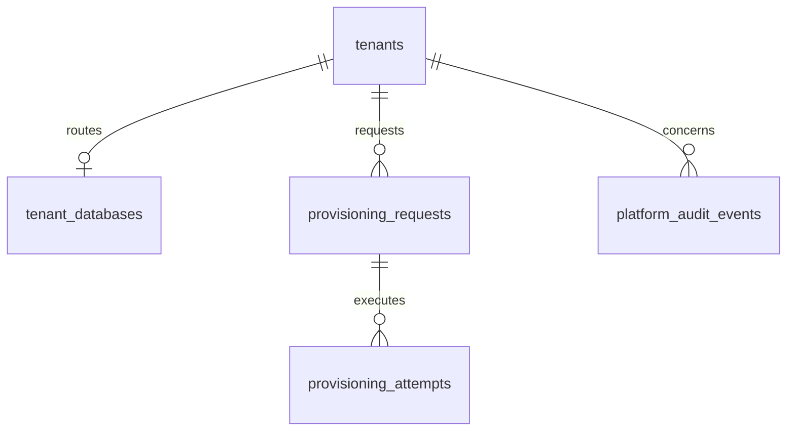

# Control-plane database schema

Design only. This document proposes the control-plane PostgreSQL schema for ACME HRMS V2. It does not create tables, migrations, or application code.

The assessment application on `main` stays unchanged. V2 work belongs on `develop/hrms-v2` and feature branches. This design was checked against `docs/product/decisions/ADR-001-multi-tenancy.md`. That ADR is the architectural source of truth. This document is a schema proposal. Reviewing it does not approve it, and it does not mean the schema has been implemented.

Labels used below:

- **ADR decision** — a direction already recorded in ADR-001. This document does not change those decisions.
- **Verified** — behavior read from the current application.
- **Proposed** — a schema or procedure recommendation that follows the ADR but is not itself an ADR decision.
- **Unresolved** — still needs an explicit choice. The consolidated list is section 16. A proposed shape in a table is not that choice.

Company user accounts, employee IDs, password hashes, and refresh-session records are tenant-database concerns. Their tables belong in the tenant-schema design. They are not tables in this document.

## 1. Purpose, scope, assumptions, and non-goals

### Purpose

Define the control-plane tables that let one FastAPI application resolve a company from its login URL, tell provisioning status from company access status, and open a connection only to that company’s database.

### Scope

- Tenant registry, provisioning lifecycle, and company access status.
- Routing metadata and secret references for tenant databases.
- Provisioning requests, execution attempts, and platform audit events.
- The boundary that keeps company authentication data out of this database.

### Assumptions

These restate ADR decisions. They are not new choices made by this document.

- One tenant is one company (ADR decision 1).
- Each tenant has its own PostgreSQL database for business data (ADR decision 2).
- The React frontend and FastAPI backend are shared. A separate application deployment per company is not the default (ADR decision 3).
- A company may have many users (ADR decision 4). Those users live in the tenant database (ADR decision 5).
- There is no control-plane company membership and no company-selection login (ADR decision 5).
- Employee, salary, salary-audit, company user, employee ID, password-hash, and refresh-session records stay in the tenant database (ADR decision 6). An employee ID is unique within its tenant.
- The control plane stores the tenant registry, routing metadata, provisioning status, company access status, and platform-level operations. Company access status is `onboard`, `active`, or `deactivated`. It is not the provisioning status. The control plane does not store company users, memberships, password hashes, or refresh sessions (ADR decision 7 and decision 15).
- A valid JWT alone does not establish that the company or the employee is still authorized (ADR decision 19).

### Non-goals

- Implementing the schema, Alembic revisions, or provisioning.
- Approving the open choices in section 16.
- Designing the tenant tables for company users, employee IDs, password hashes, or refresh sessions.
- Storing `employment_status`, company users, or refresh sessions in this schema. Employee access is governed by `employment_status` in the tenant database (ADR decision 16). This schema does not add an employee `access_status` or a document-grace column.
- Choosing who may change company `access_status`. The column itself is decided: `NOT NULL`, default `onboard`, values `onboard`, `active`, and `deactivated` (ADR decision 15).
- Choosing platform-operator authentication.
- Payroll, attendance, recruitment, self-service, or AI features.
- Copying the current assessment database.
- Storing tenant business records or company accounts in the control plane.
- Treating this document as a claim that any of these tables exist.
- Choosing a secret-store product.

## 2. Verified current implementation and its limitations

Verified from the current backend. This is assessment behavior, not V2 behavior.

| Fact | Where |
|---|---|
| Tables are `employees`, `salary_records`, `salary_audit_logs`, and `user_sessions` | `backend/app/models/` |
| `salary_records.employee_id` references `employees.id` (`ON DELETE RESTRICT`) | `backend/app/models/salary.py` |
| `salary_audit_logs.salary_record_id` references `salary_records.id` (`ON DELETE RESTRICT`) | `backend/app/models/salary_audit_log.py` |
| `employee_code` is unique across the whole employee table | `uq_employees_employee_code` |
| `user_sessions` stores `token_hash` (unique), `expires_at`, and `revoked_at` only. No user id and no tenant id | `backend/app/models/user_session.py` |
| Login checks `HR_MANAGER_USERNAME` and `HR_MANAGER_PASSWORD_HASH` from settings. There is no user table | `backend/app/services/auth.py`, `backend/app/core/config.py` |
| A valid session may read and write every employee, salary, and analytics row. Services do not filter by an owner | `backend/app/services/employee.py`, `salary.py`, `analytics.py` |
| Audit `changed_by` is the configured string `HR_MANAGER_IDENTITY`, not a foreign key | `backend/app/services/salary.py` |
| CSRF is an HMAC of the session id (`acme_csrf` cookie plus `X-CSRF-Token`). It is not a table | `backend/app/services/csrf.py` |
| Alembic head is `0004_create_user_sessions`. Pytest migrates only a database named `acme_test` | `backend/migrations/versions/`, `backend/app/core/test_database.py` |
| The seed script writes only a database named `acme_salary` and refuses `acme_test` | `backend/scripts/seed_dev_data.py` |

Limitations for V2: one shared database, one configured login, no tenant registry, no routing record, and no way to reject traffic because a company was suspended. The assessment `user_sessions` table is not a V2 refresh-session store. ADR decision 13 places refresh-token digests in the tenant database. The global `employee_code` uniqueness above is the assessment rule. ADR decision 6 limits employee ID uniqueness to one tenant. V2 cookie names are not the assessment cookie names. Cookie names and `Path` remain unresolved. The assessment CSRF HMAC is current behavior, not the V2 token construction.

## 3. Constraints inherited from ADR-001

These are ADR decisions or ADR security rules. They are not current application behavior, and they are not optional schema preferences.

- Business data and company authentication data for a company live only in that company’s database (decisions 2, 5, and 6).
- The control plane stores the tenant registry, routing metadata, provisioning status, company access status, and platform-level operations. Company access status is distinct from provisioning status. The control plane does not store company users, memberships, password hashes, or refresh sessions (decision 7 and decision 15).
- A company-specific login URL identifies the tenant to resolve. The initial deployment uses a tenant-specific subdomain under a shared domain. There is no public company directory and no company-selection login. The URL is not authorization. The authenticated identity, the token’s tenant binding, the resolved tenant, and the selected tenant database must agree. A client-supplied tenant id or database name is never authorization (decision 8).
- Company login uses the company-assigned employee ID and password (decision 11). That check runs in the tenant database.
- Access tokens are JWTs lasting 15 minutes, with the claims and RS256 signing rules in ADR decision 12. Refresh tokens are high-entropy opaque tokens lasting 7 days. Auth cookies use `HttpOnly`, `Secure`, and `SameSite=Lax` as the initial defaults. Prefer host-only cookies rather than a shared parent-domain cookie (decision 12). Only an HMAC-SHA-256 digest of the refresh token is persisted, using a server-side secret, and only in the tenant database. Rotation is required. Reuse of a rotated token revokes only its affected token family or session. There is no concurrency grace period. An employee may hold multiple independent active sessions. Store basic session and device metadata and `last_used`. Do not retain IP history by default (decision 13). Ordinary protected business requests are authenticated with the access token. A refresh token is used only at the refresh endpoint to issue a new access token, with rotation and reuse checks in the tenant database (decision 12). The refresh-session table is not part of this schema.
- Roles and permissions still apply inside the company. Database separation does not replace them (decision 9). Load the current role from the tenant database. Do not trust a role embedded in the JWT. The concrete role names and permission matrix are unresolved (ADR section 14 and section 16). They are tenant-local facts, not control-plane columns.
- The control plane is authoritative for provisioning status and for company access status (`onboard`, `active`, or `deactivated`). The tenant database is authoritative for `employment_status` (ADR decisions 15 and 16). A valid JWT alone does not authorize a protected request (decision 19). A tenant that is not Ready receives no business traffic. Company `deactivated` and provisioning status `suspended` both block normal HRMS access, even with an unexpired JWT. There is no document-access grace period (decision 17). One tenant’s failure or deactivation does not by itself take another tenant’s database offline. Protected requests read company and tenant status every time, with no short-lived status cache (decision 18). Logout revokes the current refresh session and clears auth cookies. The access JWT may remain valid until its 15-minute expiry.
- Ordinary business connections must not use a PostgreSQL superuser. Runtime privileges are separate from the privileges that create databases or apply migrations (ADR section 7). How those non-runtime privileges are split is a proposal in section 11, not a second ADR decision.
- Do not store plaintext database passwords. The ADR allows either a secret-manager reference or protected deployment configuration (ADR section 4). Do not expose credentials to the frontend or logs. Which product stores the secret, how it is injected, and how it rotates are unresolved. Company password hashes are not these database credentials.
- A business database connection is bound to the selected tenant database. Pools are not shared across tenant database configurations. Pool size and total connections are bounded. Idle, suspended, or removed tenant pools are closed safely (ADR section 7). A failed request must not leave a connection checked out for another company. Numeric pool limits and idle timeouts are unresolved.
- Tenant provisioning states are Requested, Provisioning, Migrating, Ready, Failed, and Suspended (ADR section 5). Ready means migrations succeeded and the first company administrator exists in the tenant database (decision 14). Ready is necessary before routing and is not sufficient to authorize normal HRMS business APIs. Company access status is a separate control-plane fact (decision 15).
- One Alembic invocation does not migrate every tenant database (ADR section 8). Track the revision applied, the time, and success or failure. A failed tenant stays off Ready until a retry succeeds. An assumed Alembic downgrade of every tenant is not the rollback method. Rollout order, who may retry, and how a bad or partial revision is repaired remain unresolved.
- `main` stays the assessment baseline. Implementation branches come from `develop/hrms-v2` and merge only there (decision 10 and ADR section 15).

## 4. Proposed entities and responsibilities

| Entity | Essential? | Responsibility |
|---|---|---|
| `tenants` | Yes, for this proposal | Company registry identity, the six-value provisioning status, and company access status. Not a public directory. |
| `tenant_databases` | Yes, for this proposal | One routing row per tenant: location, secret references, step log, and last applied schema revision. |
| `provisioning_requests` | Proposed | One logical create, migrate, or first-admin operation, identified by an idempotency key. |
| `provisioning_attempts` | Proposed | One execution of a logical request. Earlier executions stay stored. |
| `platform_audit_events` | Proposed, before privileged operations go live | Control-plane audit for tenant lifecycle and operator actions. Separate from tenant `salary_audit_logs`. |

This proposal does not include `users`, `tenant_memberships`, or `user_sessions`. Those names are not control-plane tables. Company accounts and refresh-token digests belong in the tenant schema. The assessment `user_sessions` table is historical and is not migrated into this database.

These are not settled tables:

- **Platform operators.** ADR section 7 requires an elevated permission separate from company roles. Operator authentication is unresolved. This proposal does not add an operator table and does not reuse company login.
- **CSRF tokens.** State-changing requests require a CSRF token and trusted `Origin` validation (ADR decision 18). This schema does not store CSRF tokens. The verified assessment HMAC is not a V2 decision.
- **Company refresh sessions.** ADR decisions 12 and 13 place refresh sessions in the tenant schema. This document does not define that table.
- **Folding `tenant_databases` into `tenants`.** Possible, but it mixes company lifecycle with connection metadata. This proposal keeps them separate.
- **One row per provisioning operation.** A single row updated on retry would erase earlier failures. This proposal separates the logical request from attempt history.

Employee, salary, salary-audit, company-user, and refresh-session tables are not control-plane entities.

## 5. Entity relationships

Proposed relationships:

- `tenant_databases.tenant_id` is unique, so a tenant has at most one routing row.
- `provisioning_requests` is one logical operation. `provisioning_attempts` is many executions of that request.
- `platform_audit_events.target_tenant_id` points at `tenants`. The actor is not a foreign key. Company users are not rows in this database, and platform-operator identity is unresolved.
- First-administrator success is a succeeded `bootstrap_admin` provisioning request. It is not a foreign key to a user, in this database or in the tenant database.
- `access_status` is a column on `tenants`. It is not a new entity and not a new relationship. The diagram above is unchanged.

Proposed foreign keys use `ON DELETE RESTRICT` unless a later row says otherwise. Suspending a tenant updates `tenants.status`. It does not delete registry, routing, provisioning, or audit rows.

## 6. Table definitions

Types below are the proposed PostgreSQL shape. Names are proposals. Constraints that section 16 still has to choose are named there, not implied by a column list.

### `tenants`

| Column | Notes |
|---|---|
| `id` | `bigint` identity, primary key. Internal only. |
| `public_id` | Unique opaque id (`uuid`). This is what logs may show. It is not a client authorization key. |
| `name` | Display name. Not unique; two companies may share a label. |
| `slug` | Unique stable key for operators. Not accepted from a browser as proof of access. |
| `status` | Provisioning lifecycle only: `requested`, `provisioning`, `migrating`, `ready`, `failed`, `suspended`. |
| `access_status` | Company access status: `onboard`, `active`, or `deactivated`. `NOT NULL`. Default `onboard`. Separate from `status`. Changing it does not change `status`, `provisioning_state`, or `routing_disposition`. |
| `created_at`, `updated_at` | `timestamptz`, not null. |

Checks: `status` is one of those six values. `access_status` is `onboard`, `active`, or `deactivated`, and it is `NOT NULL`. Index: `status` only. This proposal does not add an index on `access_status`.

`status = ready` is the provisioning gate for routing. It is not sufficient to authorize normal HRMS business APIs. Section 9 defines the ready evidence and the separate `access_status` check. The mechanism that stops a writer from setting `status` alone remains unresolved. A new company starts with `access_status = onboard`. Becoming `ready` does not set `access_status` to `active`. Who may later change `access_status` stays open in section 16.

This table is the registry used to resolve a company-specific subdomain. The initial deployment uses a tenant-specific subdomain under a shared domain. It is not a public company directory, and it does not offer a company-selection login. Which registry column the subdomain matches is unresolved. Whatever key is used, that key only selects a row. It does not authorize the caller.

### `tenant_databases`

| Column | Notes |
|---|---|
| `id` | `bigint` identity, primary key. |
| `tenant_id` | Not null, unique foreign key to `tenants.id`, `ON DELETE RESTRICT`. One routing row per tenant. |
| `provider` | Short label such as `compose` or the host product. Informational. The hosting product is unresolved. |
| `instance_ref` | Host or instance identifier. Not a full URL with a password. |
| `database_name` | Name of that tenant’s database. |
| `secret_ref` | Proposed runtime credential reference. Null while `provisioning_state` is `pending`. A business connection requires it to be non-null. No password and no full URL. |
| `migration_secret_ref` | Proposed migration credential reference in the three-reference shape. Null only while `provisioning_state` is `pending`. Required before a migrate attempt starts. Distinct from `secret_ref`. Section 16 still allows one non-runtime credential for both create and migrate; that credential is still not the runtime reference. |
| `provisioning_state` | Proposed step log: `pending`, `database_created`, `migrated`, `admin_bootstrapped`, `ready`, `failed`. |
| `routing_disposition` | Proposed: `in_service`, `quarantined`, `dropped`. Business routing requires `in_service`. |
| `schema_revision` | Last revision that a migrate attempt successfully applied and then observed in the tenant database. Null until that happens. A failed attempt does not replace this value. |
| `created_at`, `updated_at` | `timestamptz`, not null. |

Unique: `tenant_id`, and `(instance_ref, database_name)`. The pair stays unique while the row exists, including after quarantine or a recorded drop, so a retry cannot insert a second routing row for the same name.

There is no foreign key to a company user or membership. Value checks on `provisioning_state` and `routing_disposition` are part of this proposed shape. A further check that `provisioning_state = ready` requires `in_service`, a non-null `schema_revision`, and a non-null `secret_ref` is one way to enforce part of the ready invariant. Administrator success is recorded on `provisioning_requests`, not by a user foreign key. Whether a check, a trigger, or a single writer enforces the full invariant is unresolved (section 9).

The reference columns store an identifier for either ADR storage alternative: a secret-manager reference, or an identifier of a value held in protected deployment configuration. They do not name a product. They do not store company password hashes.

### `provisioning_requests`

Proposed logical operation. This is not attempt history.

| Column | Notes |
|---|---|
| `id` | `bigint` identity, primary key. |
| `tenant_id` | Not null, foreign key to `tenants.id`, `ON DELETE RESTRICT`. |
| `idempotency_key` | Not null. Combined with tenant and operation, this is the logical request. |
| `operation` | `create_database`, `migrate`, `bootstrap_admin`. |
| `target_revision` | Required for `migrate`. Set when the request is created, before any attempt runs. Null for the other operations. Later attempts copy it; they do not change it. |
| `conclusion` | `open`, `succeeded`, `failed`. The logical outcome. Updating this column does not rewrite attempt rows. |
| `created_at`, `updated_at` | `timestamptz`, not null. |

Unique: `(tenant_id, operation, idempotency_key)`.

A repeat of the same triple finds this row. It does not insert another request and does not insert another `tenant_databases` row. If `operation = create_database` and `conclusion = succeeded`, a later call does not create another database. If `operation = bootstrap_admin` and `conclusion = succeeded`, a later call of that same request does not create another administrator. The administrator row is created in the tenant database. This table records that the operation succeeded. It does not store the account.

### `provisioning_attempts`

Proposed execution history. Each run inserts a new row.

| Column | Notes |
|---|---|
| `id` | `bigint` identity, primary key. |
| `request_id` | Not null, foreign key to `provisioning_requests.id`, `ON DELETE RESTRICT`. |
| `attempt_number` | Not null. Starts at 1 and increases for each new execution of that request. |
| `status` | `started`, `succeeded`, `failed`. |
| `target_revision` | For a migrate attempt, copied from the request when this row is inserted, before migration runs. Not updated afterward. Null for other operations. |
| `alembic_revision_before` | Revision read from that tenant database’s Alembic version table at start. Null when that table or row is absent. |
| `alembic_revision_after` | Revision read after the attempt stops. Null when it still cannot be read. |
| `error_code` | Nullable stable code. Detail text must not include passwords or connection strings. |
| `started_at`, `finished_at` | Timestamps. `finished_at` set when this attempt reaches `succeeded` or `failed`. |

Unique: `(request_id, attempt_number)`. Index: `(request_id, started_at)`.

An attempt row may be completed once: set `status`, `alembic_revision_after`, `error_code`, and `finished_at` on that row. Completion does not update an earlier attempt. There is no “update the failed row in place” path.

### `platform_audit_events`

| Column | Notes |
|---|---|
| `id` | `bigint` identity, primary key. |
| `actor_ref` | Nullable text. Not a foreign key. Null when the actor is unknown. A future operator identifier may be copied here after operator authentication is chosen. It must not be a cross-database foreign key to a company user. |
| `action` | For example `tenant.requested`, `tenant.suspended`, `database.migrated`, `database.quarantined`, `database.dropped`, `admin.bootstrapped`. |
| `target_tenant_id` | Nullable foreign key to `tenants.id`. Proposed `ON DELETE RESTRICT`. |
| `outcome` | `success` or `failure`. |
| `detail` | JSON. No passwords, secret values, raw tokens, refresh-token digests, or salary payloads. |
| `created_at` | `timestamptz`, not null. |

Index: `(target_tenant_id, created_at)`, `(actor_ref, created_at)`.

Proposed retention behavior is in section 13. It does not decide tenant deletion.

This is not `salary_audit_logs`. Salary corrections stay in the tenant database.

## 7. Company identity and refresh sessions

ADR decisions 5, 6, 11, 12, and 13 settle where company authentication data lives. This section records that boundary. It does not design the tenant tables.

The tenant schema, not this document, holds:

- Company user accounts.
- Employee IDs, unique within that tenant.
- Password hashes. ADR section 6 keeps a slow hash such as Argon2id. The hash is not plaintext.
- `employment_status`, which governs employee access (ADR decision 16). There is no separate employee `access_status` and no document-grace column.
- Refresh-session records. Refresh tokens are high-entropy opaque tokens. Only an HMAC-SHA-256 digest is persisted, using a server-side secret. The access JWT and the raw refresh token are not stored. Rotation is required. Reuse of a rotated token revokes only its affected token family or session. There is no concurrency grace period. An employee may hold multiple independent active sessions. Basic session and device metadata and `last_used` are stored there. IP history is not retained by default.

Company access status is the opposite placement. `tenants.access_status` lives in this registry. It is `NOT NULL`, defaults to `onboard`, and allows `onboard`, `active`, and `deactivated`. It is not an employee column.

The refresh-session table belongs entirely to that tenant-schema design. ADR decisions 12 and 13 fix the session behavior. This control-plane proposal does not create the table and does not foreign-key it.

Login does not look up a control-plane email or a control-plane membership. The company-specific URL selects the registry row. The employee ID and password are then checked in the resolved tenant database. There is no public list of companies and no screen where the caller picks a company.

A person who works for two companies is not represented here. Each company account lives in its own tenant database, reached by that company’s login URL.

## 8. Login, tokens, and the legacy HR-manager account

**Assessment sessions.** ADR section 9 requires that existing `user_sessions` rows are not copied into tenant refresh-session records. Invalidate them. They have no user and no tenant. That is an ADR instruction, not an open choice in this document.

**Company login.** Agreed flow. Cookie names and `Path` remain open in section 16. The token and session rules below are ADR decisions 12, 13, and 18.

1. The company-specific subdomain resolves one `tenants` row. An unknown URL fails closed. The response must not be a directory of other companies. The URL is not authorization.
2. Load that tenant’s routing row. Reject the login unless the ready evidence in section 9 holds and `access_status = active`. `onboard` and `deactivated` do not authorize normal HRMS access even though the URL resolved. Do not change `status` to `suspended`.
3. Open a connection only to that tenant database.
4. Check the company-assigned employee ID and password in that database. The password hash stays there. Load the current role from that database. Do not trust a role embedded in a JWT.
5. On success, the application issues an access JWT lasting 15 minutes and a high-entropy opaque refresh token lasting 7 days. Auth cookies use `HttpOnly`, `Secure`, and `SameSite=Lax`. Prefer host-only cookies rather than a shared parent-domain cookie. The refresh-token HMAC-SHA-256 digest is stored only in that tenant database, by the tenant schema. The issued token is bound to the resolved tenant. The claims are `sub`, `tenant_id`, `jti`, `iat`, `exp`, `iss`, and `aud`. Signing is RS256 with a `kid` and a trusted JWKS endpoint.
6. A later request still has to show that the authenticated identity, the token’s tenant binding, the URL’s tenant, and the selected database are the same tenant.

State-changing requests require a CSRF token and trusted `Origin` validation. Safe HTTP methods must not mutate state. Logout revokes the current refresh session and clears auth cookies. The access JWT may remain valid until its 15-minute expiry. Other device sessions remain active. Company and employee authorization outcomes are decided in ADR decisions 15–19 and applied in sections 9 and 10. An employee may hold multiple independent active sessions. Reuse of a rotated refresh token revokes only that token family or session. There is no concurrency grace period.

**Platform operators.** Operator authentication is not this login. This schema does not define it and does not attach an operator to a company account so that company login can be reused.

**Legacy HR manager.** Verified today: username and password hash come from the environment, and `HR_MANAGER_IDENTITY` is only an audit label. There is no user row to migrate.

Proposed transition, so V2 does not weaken that check:

- V2 routes do not accept `HR_MANAGER_USERNAME` as a second login path.
- During a rehearsed cutover, create the first company administrator in the default tenant’s database. The password is a new Argon2id hash. The repository has never stored the plaintext password, so it cannot be copied. Do not create a control-plane user for that person.
- After that administrator exists, V2 company authentication reads only the tenant database named by the login URL. The environment variables remain for the assessment application on `main`.
- Do not keep a fallback that authenticates the configured HR manager when the tenant database has no matching account. That fallback would skip tenant status and the URL-to-database agreement.

## 9. Tenant lifecycle and provisioning states

`tenants.status` is the provisioning lifecycle. `tenants.access_status` is company access. `tenant_databases.provisioning_state` is a proposed step log so a retry can see the last finished step. `routing_disposition` says whether that routing row may be used. None of those fields replaces another. `status = ready` is necessary before a connection is opened and is not sufficient to authorize normal HRMS business APIs.

| ADR `tenants.status` | Meaning for routing |
|---|---|
| `requested` | Accepted for creation. Not routable. |
| `provisioning` | Database is being created. Not routable. |
| `migrating` | Schema is being applied. Not routable. |
| `ready` | Migrations succeeded and the first company administrator exists in the tenant database. The database may be routed. Normal HRMS APIs also require `access_status = active`. |
| `failed` | Creation, migration, or admin bootstrap did not finish. Not routable. |
| `suspended` | Provisioning block. Previously usable, now not routable until an operator clears `status`. This is not `access_status = deactivated`. Other tenants stay routable. |

| Proposed `provisioning_state` | Meaning while that step is the latest finished one |
|---|---|
| `pending` | No database yet. Aligns with `requested`. |
| `database_created` | Empty database exists. Aligns with `provisioning`. |
| `migrated` | A migrate attempt succeeded and `schema_revision` matches the tenant Alembic version. The first administrator does not exist yet, so `tenants.status` stays `migrating`. |
| `admin_bootstrapped` | The `bootstrap_admin` request conclusion is `succeeded`. The administrator exists in the tenant database. `tenants.status` is still not `ready`. |
| `ready` | Allowed only in the same logical transition that sets `tenants.status` to `ready`, and only when the evidence list holds. |
| `failed` | `tenants.status` is `failed`. Not a license to set `ready` on the other column. |

### Evidence that the first administrator exists

Proposed evidence, with no cross-database foreign key:

- A `provisioning_requests` row for this tenant with `operation = bootstrap_admin` and `conclusion = succeeded`.
- That request’s successful `provisioning_attempts` row remains.
- The account itself was created in the tenant database and is not stored here.

The role of that administrator is whatever the unresolved tenant role matrix later says. This document does not treat a particular role name as the evidence, and it does not point at the account.

Ready evidences that this bootstrap happened. It does not mean that same person must keep the same `employment_status` for the life of the tenant. A later change to `employment_status` stays in the tenant database and does not change `tenants.access_status`. Company deactivation is `tenants.access_status`. ADR decisions 15–19 decide the authorization outcome: a valid JWT is not enough. This document does not define which carried-forward `ACTIVE` or `INACTIVE` value permits a request.

Any tenant whose `status` is not `ready`, including `failed` and `suspended`, fails closed for normal HRMS business APIs. A tenant that is `ready` with `access_status` of `onboard` or `deactivated` is also denied those APIs, including when the access JWT has not expired. An unexpired refresh token does not authorize those APIs. Setting `access_status` does not set `status` to `suspended` and does not close another tenant’s pool. There is no document-access grace period. Employee access is then enforced from `employment_status` in the tenant database.

### Ready invariant

Proposed rule for both flags. Either flag may become `ready` only when all of the following are already true:

- The `tenant_databases` row exists for that tenant.
- `routing_disposition` is `in_service`.
- `secret_ref` is not null.
- `schema_revision` is not null and equals `alembic_revision_after` on the succeeded migrate attempt.
- That revision is one the running application is allowed to serve.
- The `bootstrap_admin` evidence above is present.

`admin_bootstrapped` is deliberately not routable. The move from that step to `ready` is one logical transition that writes `tenant_databases.provisioning_state` and `tenants.status` together. That write updates only those two provisioning fields. It does not set, clear, or overwrite `tenants.access_status`. Becoming `ready` does not make the company `active`.

Business routing in section 10 refuses the request unless every item above is visible, even if a bad write set only one `ready` flag.

### What stops the two flags from being set independently

That enforcement is unresolved. The invariant above is the proposal. The mechanism is not:

- Application transaction and tests only. A direct SQL update can still set one flag.
- A control-plane trigger that rejects `tenants.status = ready` unless the routing row is `ready`, `in_service`, has `secret_ref`, has `schema_revision`, and a succeeded `bootstrap_admin` request exists for that tenant. “Accepted by the running application” still cannot be a static list of revisions inside the database. The trigger cannot foreign-key the tenant-local administrator.
- One privileged procedure is the only writer of both columns. Ordinary table privileges cannot update them.

Until one of these is approved, this document does not claim the database prevents a split write. None of the alternatives above is a writer of `access_status`. Section 16 keeps the choice among them open.

### Retry and compensation

Progress follows the ADR sequence: `requested` → `provisioning` → `migrating` → `ready`. `failed` and `suspended` are ADR states. Leaving `suspended` returns `tenants.status` to `ready` only when the ready invariant still holds, including `routing_disposition = in_service`. That return updates `tenants.status` only. It does not set, clear, or overwrite `access_status`.

A retry inserts a new `provisioning_attempts` row for the existing request. It resumes the last successful step. It does not allocate a second database when `instance_ref` and `database_name` are already stored, and the unique pair rejects a second routing row for that name.

If a partial database will not be retried, drop or quarantine is an explicit compensation step recorded in `platform_audit_events`, as ADR section 5 requires. It is not an automatic drop. Proposed state of the same `tenant_databases` row after that step:

- `tenants.status` is `failed`.
- `provisioning_state` is `failed`.
- `routing_disposition` is `quarantined` or `dropped`, chosen by that explicit step.
- `instance_ref`, `database_name`, and `schema_revision` stay as last recorded. The row is not deleted.
- Business routing does not resolve `secret_ref`.

Failure handling in this section, including this compensation step, updates only the provisioning and routing fields named above: `tenants.status`, `provisioning_state`, and `routing_disposition`. It does not set, clear, or overwrite `access_status`. `tenants.status`, `provisioning_state`, `routing_disposition`, and `access_status` stay distinct.

The retained unique `(instance_ref, database_name)` is what blocks a silent second create. A later retry of `create_database` sees the existing name and does not pick a new one. A succeeded create conclusion does not create again.

Whether a verified drop may later clear that name and allow a new database is part of the unresolved recovery policy in section 16. Until that choice exists, compensation does not release the name.

## 10. Tenant resolution and routing

This path is for company traffic. It is not an operator path.

**Login**

1. Resolve the company-specific URL to one `tenants` row. Do not accept a tenant id or database name from the body, query, or header as the authority. Do not offer a company picker.
2. Reject unless `tenants.status = ready`, the `tenant_databases` evidence in section 9 holds, including `routing_disposition = in_service`, and `access_status = active`. Fail closed when any of those conditions is missing or does not match. `onboard` and `deactivated` deny normal HRMS access even though the URL resolved. Do not change `status` to `suspended` because the company is `onboard` or `deactivated`. This denial does not close or disrupt another tenant’s pool.
3. Open a connection only for that tenant database.
4. Authenticate the employee ID and password in that database.
5. Issue the access and refresh cookies using the decision 12 defaults. Persist only the refresh-token HMAC-SHA-256 digest, through the tenant schema, in that same database.

**Later business request**

1. Resolve the tenant from the company URL again. The URL still is not authorization.
2. Authenticate the presented access token. Do not accept a refresh token as the credential for this request. Verify the JWT with the public keys from the trusted JWKS endpoint, and refresh JWKS when an unknown `kid` is encountered. The claims are those in ADR decision 12. Do not trust a role in the JWT. The required result is agreement among the authenticated identity, the token’s tenant binding, the resolved tenant, and the selected database. Fail closed on any disagreement. A refresh token is accepted only at the refresh endpoint, where it is exchanged for a new access token and the tenant database enforces rotation and reuse checks.
3. Load `tenants` and `tenant_databases` from the control plane. Do not load a company user, `employment_status`, or refresh session from the control plane. Reject unless the ready evidence still holds, including `routing_disposition = in_service`, and `access_status = active`. Fail closed when any of those conditions is missing or does not match. `onboard` and `deactivated` deny normal HRMS business APIs even when the access JWT is unexpired. An unexpired refresh token does not authorize those APIs. Do not change `status` to `suspended` because the company is `onboard` or `deactivated`, and do not close or disrupt another tenant’s pool.
4. Open or reuse a connection only for that tenant database when the request is still allowed. A company that is not `active` does not receive a normal business connection.
5. Apply the company role and permission check in the tenant database, using the current role stored there. The matrix is unresolved. The tenant database then enforces `employment_status`. There is no document-access grace period.
6. Release the connection as defined below, whether the request succeeds or fails.

A non-ready, failed, or suspended tenant receives no business traffic. Company `deactivated` also blocks normal HRMS access. Refresh-token rotation runs in the tenant database. Reuse of a rotated token revokes only that token family or session. There is no concurrency grace period. Logout revokes the current refresh session and clears auth cookies. The access JWT may remain valid until its 15-minute expiry. Other device sessions remain active. This schema does not add an access-token denylist.

**Time-of-check/time-of-use.** Do not cache “this tenant is ready” or “this company is active” for the life of a token. Read `tenants.status` and `tenants.access_status` on every protected request, before the tenant connection is used for business work. The initial design does not use a short-lived status cache (ADR decision 18). `employment_status` is not a control-plane column.

If the routing lookup or the connection open fails, the request fails closed. It must not fall back to another tenant’s pool or to the assessment `DATABASE_URL`. One tenant’s failure does not require closing another tenant’s pool.

**Connection cleanup.** This is required by ADR section 7, which says a request that finishes or fails must not leave a connection checked out for another company.

- The acquired connection belongs only to the pool for the resolved `instance_ref`, `database_name`, and runtime credential reference.
- If a later authorization check fails, or any later error fails the request, return that connection only to that same pool, then stop.
- If that pool was closed because the tenant was suspended, failed, quarantined, dropped, or idled out during the request, discard the connection. Do not return it to a process-wide pool, a different tenant, a different database name, or the assessment `DATABASE_URL`.
- A role failure is not a reason to open a second tenant’s database.

## 11. Credentials and privileges

ADR section 7 distinguishes the business request path from the privileges that create databases and apply migrations. Ordinary business requests must not connect as a PostgreSQL superuser. ADR section 4 allows either a secret-manager reference or protected deployment configuration, and forbids plaintext database passwords in the control plane, git, the frontend, and logs.

This proposal uses three database privileges. The ADR requires the runtime privilege to be separate from the other work. Splitting database creation from migration into two references is a proposal, not an extra ADR decision. One non-runtime credential used for both create and migrate would also meet the ADR, and that alternative is open in section 16.

| Privilege | Proposed reference | May do | Must not do |
|---|---|---|---|
| Runtime | `tenant_databases.secret_ref` | Read and write that tenant’s business schema on HTTP requests | Superuser actions, `CREATE DATABASE`, tenant DDL, or use on another tenant |
| Migration | `tenant_databases.migration_secret_ref` | Apply Alembic DDL on that tenant database | Serve HTTP requests, or create the database |
| Database provisioning | A reference that is not a password column | Create the empty database and its least-privilege roles | Serve HTTP requests, or act as the runtime login |

`migration_secret_ref` is null only while `provisioning_state` is `pending`. It is required before a migrate attempt is inserted. It is not an optional substitute for `secret_ref`.

The provisioning reference is not a per-tenant password. Recording it as another secret-manager reference or in protected deployment configuration are the two ADR storage alternatives. Whether each tenant has its own provisioning reference, or the platform holds one server-level reference, is unresolved. This document does not name a secret-store product.

Company password hashes are not stored in these columns. They stay in the tenant database.

At runtime the process resolves the chosen reference and builds the connection in memory. Logs may record `tenant public_id` and the reference identifier, not the secret. The frontend never receives database names, hosts, or secret values.

**Injection and rotation are unresolved.** ADR section 14 leaves where database credentials live, how they are injected, and how they rotate. This proposal only fixes the shape of the stored reference. It does not choose an injector, a rotation period, or whether an old reference version stays valid during a rollout.

## 12. Migration strategy

Two Alembic histories, not one head:

- Control-plane revisions create and alter the tables in this document.
- Tenant revisions carry the employee, salary, and audit schema, and, in V2, the company-user and refresh-session schema. That second group is specified by the tenant-schema design, not here. Each tenant database receives its own rollout.

The current repository has a single history ending at `0004_create_user_sessions` and a single `DATABASE_URL`. That history is the assessment database. V2 must not point that same command at every tenant and assume they all moved. Intended V2 behavior is one controlled rollout per tenant database (ADR section 8).

Per migrate attempt:

- The logical `provisioning_requests.target_revision` is set before the first attempt.
- Each attempt copies that value into `provisioning_attempts.target_revision` when the attempt row is inserted, before Alembic runs.
- At start, read the tenant database’s Alembic version into `alembic_revision_before`.
- At end, read it again into `alembic_revision_after`.
- Update `tenant_databases.schema_revision` only when this attempt’s status becomes `succeeded` and `alembic_revision_after` equals `target_revision`, and `alembic_revision_before` equals the previous `schema_revision` (both null when nothing has been applied).
- On any other outcome, leave `schema_revision` at the last successful value. Set the attempt to `failed`. Set `tenants.status` and `provisioning_state` to `failed`. Do not set either flag to `ready`. This failure handling does not set, clear, or overwrite `tenants.access_status`.

`schema_revision` means “last revision successfully applied and observed.” `target_revision` means “revision this request intended.” `alembic_revision_before` and `alembic_revision_after` mean “what that tenant database reported.”

**Discrepancy.** A discrepancy exists when any of these is true:

- `alembic_revision_before` differs from `schema_revision`, treating two nulls as the same.
- The attempt ends and `alembic_revision_after` differs from `target_revision`.
- `alembic_revision_after` differs from `schema_revision` after a failure, which is the partial-apply case: the tenant version moved and the control plane still records the previous success.

Detection is that comparison, performed at the start and end of the attempt and again before any business connection. Handling until a recovery policy is approved: do not route, do not overwrite `schema_revision` with the attempted revision, keep the attempt row, and leave the tenant `failed`. Leaving it `failed` does not set, clear, or overwrite `tenants.access_status`. The next attempt must read `alembic_revision_before` again rather than assume the database is empty.

**Recovery policy is unresolved.** ADR section 8 already says rollback is restore or a forward fix, not an assumed downgrade of every tenant. Still open: rollout order, who may retry, whether a partial tenant is restored or repaired forward, and whether the control-plane revision or the tenant Alembic version wins when they disagree. This document does not choose among those.

A retry of the same idempotency key adds an attempt. It does not create a second database. Creating a database is refused when `(instance_ref, database_name)` is already stored.

The control-plane migration itself is one database. It does not migrate tenant databases as a side effect.

Development seed follows ADR section 10 as a recommendation, not as a new decision: the 10,000-employee generator stays development-only for an explicitly selected tenant database, must refuse `acme_test`, and must not scan every tenant or write a production URL. Pytest continues to migrate only `acme_test`.

## 13. Integrity, retention, backups, observability, and recovery

Proposed foreign keys:

- Routing rows, provisioning requests, and provisioning attempts use `ON DELETE RESTRICT`, so a tenant row is not removed while those children remain.
- `platform_audit_events.target_tenant_id` uses `ON DELETE RESTRICT`. `actor_ref` is not a foreign key, so there is nothing to null or cascade when a company user is deactivated or deleted. An alternative that stored a control-plane user id is superseded because this schema has no company user table. `RESTRICT` on the tenant keeps the audit row attributable to a registry row. It also means a tenant row cannot be deleted while an audit event points at it.

Suspension and deactivation do not delete control-plane rows:

- `tenants.status = suspended` does not delete `platform_audit_events`, routing rows, or provisioning history. It is a provisioning block, not a change to `access_status`.
- Company deactivation updates `tenants.access_status` to `deactivated`. It does not delete the tenant registry row, the routing row, or audit records, and it does not set `status` to `suspended`.
- `employment_status` stays in the tenant database. Changing it does not rewrite platform audit rows and does not add an employee access column. There is no control-plane session row to revoke.
- Refresh-session revocation is tenant-local. This document does not describe its columns. Logout revokes the current refresh session and clears auth cookies. The access JWT may remain valid until its 15-minute expiry. Other device sessions remain active. This schema does not add an access-token denylist.

Tenant deletion, retention, and offboarding are unresolved. `RESTRICT` is a proposed way to keep audit rows valid until that policy exists. It is not an approval to delete a tenant database, to archive audit rows, or to keep them forever. Section 16 holds that choice. Compensation in section 9 quarantines or records a drop of a partial database; it still does not delete the control-plane audit or the routing row.

**Tenant salary audit.** Verified today: `salary_audit_logs.changed_by` is a string, the configured `HR_MANAGER_IDENTITY`, not a foreign key. Proposed for V2: `changed_by` remains a non-key identifier stored in the tenant database, such as the employee ID or a display label copied when the salary row is written. It is not a foreign key to a control-plane table. A cross-database foreign key is not proposed.

Consequences of that proposal:

- Deactivating or deleting a tenant-local user does not delete or rewrite salary-audit rows through the control plane.
- After a user is gone, the stored string remains. It may no longer match a live user. The salary history still matches its salary row through the tenant-local foreign keys that exist today.
- The company user table lives in the tenant schema. That design must not turn these audit strings into a foreign key back to the control plane.

**Backups and metrics are unresolved as an operational program.** ADR section 14 leaves backup, restore, disaster recovery, and the metrics that show Ready or Failed. ADR section 11 only records that per-company backup is a benefit of database-per-tenant. Proposed consequence, not a runbook: take the control-plane backup separately from each tenant database. Restoring a tenant database without its `tenant_databases` row leaves an orphan that section 14 refuses to route. Restoring the control plane without the tenant database leaves a registry entry that must not become `ready`. Frequencies, drills, and recovery-time targets are not chosen here.

Fields that are safe to emit, if metrics are added later: tenant `public_id`, status, provisioning state, routing disposition, schema revision, attempt outcome, pool size, connection-acquire failure. Not safe: SQL that contains a password, raw tokens, refresh-token digests, or password hashes. Which of those fields means Ready or Failed is unresolved.

Connection pools, when implemented, follow ADR section 7:

- One pool configuration per tenant database configuration, not a shared pool of connections that differ by database name.
- A cap per tenant and a cap for the process. The numbers are unresolved.
- On suspend, fail, quarantine, drop, or idle timeout, close that pool and discard leftover connections. Do not hand them to another tenant. Section 10 is the same rule for a connection already checked out.

## 14. Security risks and mitigations

| Risk | Mitigation |
|---|---|
| Client sends another company’s id or database name | Ignore it as authorization. The login URL only selects a registry row. The token, the identity, the resolved tenant, and the database must still agree. |
| Public company directory or company picker | Not provided. An unknown URL fails closed and does not list tenants. |
| Token for tenant A presented on tenant B’s URL | Fail closed. Do not open tenant B’s database for that token. |
| Plaintext database password in SQL | Store database-credential references only. Company password hashes stay in the tenant database. |
| Superuser on the request path | The runtime reference is not a superuser and is not the migration or provisioning reference. |
| Duplicate database on retry | The logical request is unique. Attempt rows accumulate. `(instance_ref, database_name)` stays reserved after quarantine or a recorded drop. |
| Second administrator on retry of the same bootstrap | A succeeded `bootstrap_admin` request does not create another administrator. The account is tenant-local. |
| Database exists, registry row does not | Not routable. An operator reconciliation may attach it or quarantine it. The application must not discover databases by listing the server and serving them. |
| Registry row exists, database does not | `provisioning_state` cannot be `ready`. Requests fail closed. |
| Control plane unavailable | Fail closed for login and business routes. Do not use a cached tenant connection as if status were still `ready`. Do not fall through to another tenant. |
| Platform operator confused with a company role | Company login is not the operator path. Operator authentication is unresolved and is not a column in this schema. |
| Authorization fails after a connection was opened | Return the connection only to that tenant’s pool, or discard it if that pool is gone. |
| Assessment env login left enabled on V2 | V2 does not honor `HR_MANAGER_USERNAME` as a fallback. |
| Cross-tenant pool leak | Pools are keyed by the resolved tenant database configuration and are not shared. |
| Salary data or refresh tokens copied into the control plane | Control-plane tables have no employee, salary, password-hash, or refresh-token columns. Platform audit JSON must not include those values. |
| User deletion erases salary history | Proposed `changed_by` is a non-key string in the tenant database. There is no control-plane user cascade. |
| Already-issued JWT while the company is not `active`, or the employee is no longer authorized | ADR decisions 15–19 fix the authorization outcome. A valid JWT is not enough. A non-ready, failed, or suspended tenant fails closed. A ready company whose `access_status` is `onboard` or `deactivated` is denied normal HRMS APIs even if the access JWT is unexpired. An unexpired refresh token does not authorize those APIs. There is no document-access grace period. Employee access follows `employment_status` in the tenant database. Logout revokes the current refresh session only. This schema does not add an access-token denylist. |

## 15. Test strategy

Tests write only to an isolated test control-plane database and isolated test tenant databases. They must keep the current rule that pytest does not migrate `acme_salary`. Company-user and refresh-session assertions run against the tenant schema once that schema exists. They do not require control-plane user, membership, or session tables.

Prove at least:

- The company login URL resolves one registry row and opens only that tenant’s database.
- Two users in one company see that company’s employees and not another company’s, once tenant-local accounts exist.
- A second company has its own database. Primary keys may overlap; routing still separates them.
- A request that passes `tenant_id` or `database_name` for the other company still uses the URL’s tenant, and only when the token binding agrees.
- A token bound to tenant A is rejected for tenant B.
- After tenant `suspended` or any non-ready status, that tenant’s next business request fails, and another ready tenant still routes.
- A tenant with `status = ready` and `access_status` of `onboard` or `deactivated` is denied normal HRMS business APIs, including with an unexpired JWT, while another `active` tenant remains routable. `status` stays `ready`. There is no document-access grace period. `employment_status` cases are tenant-schema tests, not control-plane columns.
- A connection checked out for tenant A is not used for tenant B, including when the company role check fails after the connection was acquired. The connection is not returned to tenant B’s pool.
- The same idempotency key inserts another attempt and does not create a second database, a second routing row, or a second administrator for that same bootstrap request. The earlier failed attempt row still shows its error.
- A migrate whose observed Alembic version disagrees with `schema_revision` or `target_revision` leaves `schema_revision` unchanged and does not mark the tenant ready.
- A tenant row without the ready evidence, including a missing succeeded `bootstrap_admin` request, is denied. A database name with no tenant row is denied.
- When the control plane cannot be reached, business calls fail and do not open another tenant’s database.
- A company role cannot call platform provisioning. The operator path is tested only after section 16 chooses one.
- Refresh-token rotation is tested in the tenant database. Reuse of a rotated token revokes only that token family or session. There is no concurrency grace period.
- Existing employee, salary, audit, and analytics behavior still passes against a single test tenant database once those tests are pointed at the V2 login. Until that work exists, the assessment suite on `main` stays as it is.

## 16. Open decisions

Every item below needs an explicit approval before implementation treats it as decided. Alternatives are listed with their implications. This section does not select one.

Rows that assumed company users, memberships, or sessions in the control plane are superseded. ADR decisions 5, 6, 7, 11, 12, 13, and 14 place that data in the tenant database. They are not reopened here. Assessment `user_sessions` are invalidated and are not copied (ADR section 9).

| Topic | Alternatives and implications |
|---|---|
| Cookie names and `Path` | `HttpOnly`, `Secure`, and `SameSite=Lax` are the initial defaults. Prefer host-only cookies rather than a shared parent-domain cookie (ADR decision 12). Cookie names and `Path` are unresolved. This schema does not store cookies. |
| Platform-operator authentication | Unresolved and separate from company login. This proposal does not add an operator table, a `platform_role` column, or a company membership for operators. |
| Login URL key | The initial deployment uses a tenant-specific subdomain under a shared domain (ADR decision 8). Which `tenants` column that subdomain matches is unresolved. The chosen value selects a registry row and is not authorization. A public directory remains forbidden. |
| Roles and permissions | The matrix is unresolved, including any starter names. ADR decision 9 still requires a company role check inside the tenant database. A company role is not the operator permission. |
| First-admin onboarding | How the first person proves identity, how the password is set, and who may start `bootstrap_admin`. The account is created in the tenant database. The control-plane evidence is the succeeded provisioning request, not a user foreign key. |
| Ready-flag enforcement | Application transaction and tests; a database trigger; or a single privileged writer. Only the latter two stop a direct SQL update of one `ready` flag. The trigger still cannot encode “revision accepted by this application build,” and it cannot foreign-key the tenant-local administrator. Whichever of those writers is later selected updates only the provisioning fields that transition names, including `tenants.status` and `tenant_databases.provisioning_state`. It does not set or clear `access_status`. Who owns that writer stays one of the three alternatives above. |
| Credential split | Three references, as section 11 proposes, or one non-runtime credential for both create and migrate. The ADR already requires that runtime not be that credential, and that business requests not use a superuser. |
| Credential storage product, injection, and rotation | The ADR already allows a secret-manager reference or protected deployment configuration for database credentials. Still open: which product, how the process receives the secret, how rotation works, and whether provisioning is one server-level reference or one reference per tenant. No product is chosen here. |
| Database hosting and naming | Where tenant PostgreSQL instances run, and how `database_name` is formed. Uniqueness of `(instance_ref, database_name)` is the proposed collision guard. A name based on the company label can leak that label. A dedicated instance for a large tenant is an unresolved hosting choice. Changing `instance_ref` later would be a consequence of that choice, not a separate application. |
| Connection-pool limits | Per-tenant size, process-wide cap, and idle timeout. ADR section 7 requires bounds and safe close of idle, suspended, failed, or removed pools. The numbers and the exact idle policy are open. Dropped and quarantined pools are closed and not reused, which is the proposal in section 10. |
| Migration retry and recovery | Who may retry, the order of a fleet rollout, and how a bad or partial revision is repaired. ADR section 8 already excludes an assumed downgrade of every tenant and allows restore or a forward fix. Still open: which of those runs, what happens when `schema_revision` and the tenant Alembic version disagree, and whether a verified drop may release `(instance_ref, database_name)`. Until then, discrepancy handling fails closed and does not overwrite the last successful revision. |
| Deletion, retention, and offboarding | Both `status = suspended` and `access_status = deactivated` block that tenant’s business traffic. They are different states and must not be stored as each other. Deleting a tenant database, retaining or purging control-plane rows, and offboarding a company are not decided. Proposed `ON DELETE RESTRICT` on platform audit blocks deleting a tenant row while events exist. It does not set a retention period. |
| Backup, restore, and disaster recovery | Separate control-plane and per-tenant backups are a consequence of the ADR, not a schedule. Restore order, drills, and recovery targets are open. A restore that pairs a registry row with the wrong database must not become `ready`. |
| Readiness and failure metrics | Which signals mean Ready or Failed, beyond the stored status columns. Safe field names are listed in section 13. The operational definition is open. |
| Cross-tenant analytics | Not in this schema. Any later platform report needs an operator path. It must not reuse a company user’s connection to another tenant (ADR section 11). |
| Company access-status changes | The column is decided: `NOT NULL`, default `onboard`, values `onboard`, `active`, and `deactivated`. A new company starts as `onboard`. Becoming `ready` does not set `active`. Still open: who may change `access_status`; which transitions among `onboard`, `active`, and `deactivated` are permitted; which provisioning states, if any, are preconditions; whether every change must append a `platform_audit_events` row; which `action` value that row would use; and whether `actor_ref` may be null. The existing audit columns could record the event without a new actor entity or foreign key. This row does not require that audit row and does not select an actor. ADR-001 §7 item 8 still requires an elevated operator permission for registry and provisioning operations. It does not decide whether a change to `access_status` is one of those operations. Platform-operator authentication and concrete operator permissions stay open. |

## 17. Phased implementation and approval checklist

Order, after this document is accepted. Acceptance is a separate decision. This review does not accept the schema. Section 16 items used by a phase have to be chosen before that phase starts. The tenant-schema design is a separate document and has to exist before company login can be implemented.

1. Branch from the latest `develop/hrms-v2`. Do not commit the schema to `main`.
2. Add a control-plane Alembic history with `tenants`, including `status` and `access_status`, and `tenant_databases`. Do not add company users, memberships, sessions, an employee `access_status`, or a grace-period column.
3. Add `provisioning_requests` and `provisioning_attempts`, including the target revision, observed Alembic versions, and `bootstrap_admin` evidence. Compensation sets `routing_disposition` and does not delete the routing row.
4. Add `platform_audit_events` for those privileged steps. `target_tenant_id` uses `ON DELETE RESTRICT`. `actor_ref` stays a non-key label.
5. Resolve a company URL to one registry row. Open that tenant database for normal HRMS access only when the ready evidence holds and `access_status = active`. A deactivated company stays `ready` if provisioning says so, and its denial does not close another tenant’s pool. Release connections as section 10 describes.
6. In the tenant schema, add company users and refresh-session records. Employee access uses `employment_status`. Do not add a separate employee `access_status` or a grace-period column. Do not add those authentication tables to the control plane. Company login then uses the employee ID and password in the resolved tenant database.
7. Issue auth cookies with the ADR decision 12 defaults. Cookie names and `Path` still need a recorded choice before implementation. Persist refresh-token HMAC-SHA-256 digests only in the tenant database.
8. Rehearse a copy of assessment employees, salaries, and audit rows into a disposable tenant database. Keep `changed_by` as a non-key value. Invalidate old assessment sessions. Do not copy them into refresh-session records.
9. Run isolation tests and the existing regression tests against test databases only.
10. Review and merge into `develop/hrms-v2` only.

The assessment baseline on `main` stays as it is, including its single database, environment HR-manager login, and Alembic history.

Approval checklist:

- [ ] Section 16 choices used by the implementation are written down as decisions. Untouched rows stay open.
- [ ] No control-plane table for company users, memberships, password hashes, or refresh sessions.
- [ ] No plaintext database password column, and no cross-database foreign key to a company user.
- [ ] The runtime credential is not a superuser and is not the credential that creates databases or applies migrations.
- [ ] `tenants.status` stays the six provisioning values, and `access_status` is `NOT NULL` with default `onboard` and values `onboard`, `active`, and `deactivated`.
- [ ] A non-ready, failed, or suspended tenant fails closed without taking another tenant’s database offline.
- [ ] A ready company whose access status is `onboard` or `deactivated` is denied normal HRMS APIs without setting `status` to `suspended`. There is no document-access grace period.
- [ ] The login URL and client tenant or database fields are not authorization.
- [ ] A failed authorization after checkout cannot return the connection to another tenant.
- [ ] Provisioning retries add attempt rows and cannot create a second database for the same stored name.
- [ ] `schema_revision` changes only after the tenant Alembic version matches the successful target.
- [ ] Ready requires a succeeded `bootstrap_admin` request whose account lives in the tenant database.
- [ ] Control-plane outage fails closed.
- [ ] Assessment `main` behavior is not modified by this document.

## 18. ADR consistency review

Checked against `docs/product/decisions/ADR-001-multi-tenancy.md` after company authentication moved into the tenant database. This pass does not approve the schema.

**Aligned with the ADR.** Shared application, one business database per company, company users and refresh-token digests in that database, control-plane registry, routing, provisioning status, company access status, and platform operations, a tenant subdomain selects the tenant and is not authorization, the identity, token binding, tenant, and database must agree, no public company directory, no company-selection login, no cross-database user foreign key, first administrator created in the tenant database, non-superuser runtime access, secret references instead of plaintext database passwords, bounded pools, fail-closed provisioning, `access_status` of `onboard`, `active`, or `deactivated` kept separate from provisioning status, `ready` does not set `active`, company `deactivated` and provisioning `suspended` both block normal HRMS access, no document-access grace period, one tenant’s failure or deactivation does not stop the others, per-tenant Alembic rollout, no assumed downgrade of every tenant, assessment sessions invalidated rather than copied, and implementation only on `develop/hrms-v2`.

**Corrections in this edit.**

- Removed the proposed control-plane `users`, `tenant_memberships`, and `user_sessions` tables, their relationships, and their indexes.
- Company login is employee ID and password in the tenant database selected by the company URL. It is not a control-plane email lookup and not a membership lookup.
- First-administrator evidence is a succeeded `bootstrap_admin` provisioning request. `first_admin_membership_id` is gone.
- Platform audit no longer has `actor_user_id`. `actor_ref` is a non-key label. `target_tenant_id` still references `tenants`.
- The refresh-session table is explicitly left to the tenant-schema design. Refresh tokens are high-entropy opaque tokens. Only the HMAC-SHA-256 digest is stored, in the tenant database. Rotation is required. Reuse of a rotated token revokes only that token family or session. There is no concurrency grace period. Multiple independent sessions are allowed. Basic session and device metadata and `last_used` are stored. IP history is not retained by default.
- Superseded open rows for control-plane identity, email uniqueness, membership constraints, and session cutover. Session cutover now follows ADR section 9.
- `tenants.access_status` is `NOT NULL`, defaults to `onboard`, and allows `onboard`, `active`, and `deactivated`. `tenants.status` remains the six-value provisioning lifecycle. Employee access stays on tenant `employment_status`. There is no document-grace column.

**Remaining decisions.** The open questions in section 16, including cookie names and `Path`, which registry column the subdomain matches, who may change `access_status` and which transitions are permitted, and platform-operator authentication. ADR decisions 12–19 are not reopened there. Settled facts recorded inside an open row, such as the cookie attribute defaults and the `access_status` column rules, stay decided.

This document proposes a schema only. No application code, database schema, migration, or tenant provisioning has been changed.
