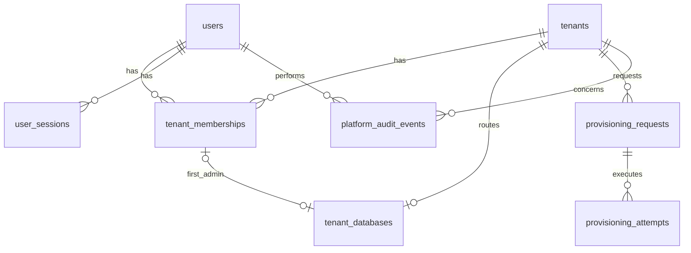

# Control-plane database schema

Design only. This document proposes the control-plane PostgreSQL schema for ACME HRMS V2. It does not create tables, migrations, or application code.

The assessment application on `main` stays unchanged. V2 work belongs on `develop/hrms-v2` and feature branches. This design was checked against `docs/product/decisions/ADR-001-multi-tenancy.md`. That ADR is the architectural direction. This document is a schema proposal. Reviewing it does not approve it, and it does not mean the schema has been implemented.

Labels used below:

- **ADR decision** — a direction already recorded in ADR-001. This document does not change those decisions.
- **Verified** — behavior read from the current application.
- **Proposed** — a schema or procedure recommendation that follows the ADR but is not itself an ADR decision.
- **Unresolved** — still needs an explicit choice. The consolidated list is section 16. A proposed shape in a table is not that choice.

## 1. Purpose, scope, assumptions, and non-goals

### Purpose

Define the control-plane tables that let one FastAPI application authenticate users, decide which company they may act for, and open a connection only to that company’s database.

### Scope

- Tenant registry and lifecycle.
- User identity and company membership in the control plane.
- Server-side sessions compatible with the current opaque-token and CSRF approach.
- Routing metadata and secret references for tenant databases.
- Provisioning requests, execution attempts, and platform audit events.

### Assumptions

These restate ADR decisions. They are not new choices made by this document.

- One tenant is one company (ADR decision 1).
- Each tenant has its own PostgreSQL database for business data (ADR decision 2).
- The React frontend and FastAPI backend are shared. A separate application deployment per company is not the default (ADR decision 3).
- A company may have many users (ADR decision 4).
- Initially each user has one company. Membership must still be able to grow to more than one company later without replacing `users` (ADR decision 5).
- Employee, salary, and salary-audit rows stay in the tenant database (ADR decision 6).

### Non-goals

- Implementing the schema, Alembic revisions, or provisioning.
- Approving the open choices in section 16.
- Payroll, attendance, recruitment, self-service, or AI features.
- Copying the current assessment database.
- Storing tenant business records in the control plane.
- Treating this document as a claim that any of these tables exist.
- Choosing a secret-store product.

## 2. Verified current implementation and its limitations

Verified from the current backend. This is assessment behavior, not V2 behavior.

| Fact | Where |
|---|---|
| Tables are `employees`, `salary_records`, `salary_audit_logs`, and `user_sessions` | `backend/app/models/` |
| `salary_records.employee_id` references `employees.id` (`ON DELETE RESTRICT`) | `backend/app/models/salary.py` |
| `salary_audit_logs.salary_record_id` references `salary_records.id` (`ON DELETE RESTRICT`) | `backend/app/models/salary_audit_log.py` |
| `employee_code` is unique across the whole employee table | `uq_employees_employee_code` |
| `user_sessions` stores `token_hash` (unique), `expires_at`, and `revoked_at` only. No user id and no tenant id | `backend/app/models/user_session.py` |
| Login checks `HR_MANAGER_USERNAME` and `HR_MANAGER_PASSWORD_HASH` from settings. There is no user table | `backend/app/services/auth.py`, `backend/app/core/config.py` |
| A valid session may read and write every employee, salary, and analytics row. Services do not filter by an owner | `backend/app/services/employee.py`, `salary.py`, `analytics.py` |
| Audit `changed_by` is the configured string `HR_MANAGER_IDENTITY`, not a foreign key | `backend/app/services/salary.py` |
| CSRF is an HMAC of the session id (`acme_csrf` cookie plus `X-CSRF-Token`). It is not a table | `backend/app/services/csrf.py` |
| Alembic head is `0004_create_user_sessions`. Pytest migrates only a database named `acme_test` | `backend/migrations/versions/`, `backend/app/core/test_database.py` |
| The seed script writes only a database named `acme_salary` and refuses `acme_test` | `backend/scripts/seed_dev_data.py` |

Limitations for V2: one shared database, one configured login, no tenant registry, no membership, no routing record, and no way to reject a session because a company was suspended. The existing `user_sessions` table is not the control-plane session table proposed below. Reusing that table in place would keep sessions in the business database.

## 3. Constraints inherited from ADR-001

These are ADR decisions or ADR security rules. They are not current application behavior, and they are not optional schema preferences.

- Business data for a company lives only in that company’s database (decisions 2 and 6).
- The control plane stores the tenant registry, identity, membership, routing metadata, and provisioning status (decision 7).
- The server resolves the tenant from the authenticated user and an authorized membership. A client-supplied tenant id or database name is never authorization (decision 8).
- Roles and permissions still apply inside the company. Database separation does not replace them (decision 9). The concrete role names and permission matrix are unresolved (ADR section 14 and section 16).
- The control plane is authoritative for user status, membership, and tenant status. Recheck them before business-data access, including for a session that was already issued (ADR section 6).
- Ordinary business connections must not use a PostgreSQL superuser. Runtime privileges are separate from the privileges that create databases or apply migrations (ADR section 7). How those non-runtime privileges are split is a proposal in section 11, not a second ADR decision.
- Do not store plaintext database passwords. The ADR allows either a secret-manager reference or protected deployment configuration (ADR section 4). Do not expose credentials to the frontend or logs. Which product stores the secret, how it is injected, and how it rotates are unresolved.
- A business database session is bound to the selected tenant database. Pools are not shared across tenant database configurations. Pool size and total connections are bounded. Idle, suspended, or removed tenant pools are closed safely (ADR section 7). A failed request must not leave a connection checked out for another company (ADR section 7). Numeric pool limits and idle timeouts are unresolved.
- Tenant lifecycle states used for routing are Requested, Provisioning, Migrating, Ready, Failed, and Suspended (ADR section 5). Ready means migrations succeeded and the first company administrator exists.
- One Alembic invocation does not migrate every tenant database (ADR section 8). Track the revision applied, the time, and success or failure. A failed tenant stays off Ready until a retry succeeds. An assumed Alembic downgrade of every tenant is not the rollback method (ADR section 8). Rollout order, who may retry, and how a bad or partial revision is repaired remain unresolved.
- `main` stays the assessment baseline. Implementation branches come from `develop/hrms-v2` and merge only there (decision 10 and ADR section 15).

## 4. Proposed entities and responsibilities

| Entity | Essential? | Responsibility |
|---|---|---|
| `tenants` | Yes, for this proposal | Company identity and the ADR lifecycle status. |
| `users` | Yes, in the control plane, for this proposal | Login identity, password hash, and account status. Whether the tenant database also has a user table is unresolved. |
| `tenant_memberships` | Yes, for this proposal | Which user may act in which company, membership status, and company role. |
| `user_sessions` | Yes, in the control plane, for this proposal | Opaque session-token hashes, expiry, revocation, and the user the session belongs to. Not the current assessment table. The session shape for a platform operator with no company is unresolved. |
| `tenant_databases` | Yes, for this proposal | One routing row per tenant: location, secret references, step log, last applied schema revision, and evidence of the first administrator. |
| `provisioning_requests` | Proposed | One logical create, migrate, or first-admin operation, identified by an idempotency key. |
| `provisioning_attempts` | Proposed | One execution of a logical request. Earlier executions stay stored. |
| `platform_audit_events` | Proposed, before privileged operations go live | Control-plane audit for tenant lifecycle and operator actions. Separate from tenant `salary_audit_logs`. |

These are not settled tables:

- **Platform operators.** ADR section 7 requires an elevated permission separate from company HR roles. This proposal does not add `users.platform_role` and does not add a `platform_operators` table. Both are alternatives in section 16.
- **CSRF tokens.** Proposed: keep them as signed values bound to the session id, as today. Do not store CSRF secrets per session in SQL. Keeping CSRF on state-changing browser requests is an ADR rule (ADR section 6).
- **Folding `tenant_databases` into `tenants`.** Possible, but it mixes company lifecycle with connection metadata. This proposal keeps them separate.
- **One row per provisioning operation.** A single row updated on retry would erase earlier failures. This proposal separates the logical request from attempt history.

Employee, salary, and salary-audit tables are not control-plane entities.

## 5. Entity relationships

Proposed relationships:

- `tenant_databases.tenant_id` is unique, so a tenant has at most one routing row.
- `tenant_databases.first_admin_membership_id` points at the membership created for the first company administrator. It is null until that bootstrap succeeds.
- A user may have many memberships over time. How a `removed` row interacts with a later add, and how the first release enforces one active company, are unresolved constraints in section 16. ADR decision 5 still requires the first release to be one company per user, with a model that can grow later.
- `provisioning_requests` is one logical operation. `provisioning_attempts` is many executions of that request.
- `user_sessions.tenant_id` in the company-user proposal points at `tenants`. Operator sessions are not in this diagram because that shape is unresolved.

Proposed foreign keys use `ON DELETE RESTRICT` unless a later row says otherwise. Deactivation and suspension are status updates, not deletes.

## 6. Table definitions

Types below are the proposed PostgreSQL shape. Names are proposals. Constraints that section 16 still has to choose are named there, not implied by a column list.

### `tenants`

| Column | Notes |
|---|---|
| `id` | `bigint` identity, primary key. Internal only. |
| `public_id` | Unique opaque id (`uuid`). This is what logs may show. It is not a client authorization key. |
| `name` | Display name. Not unique; two companies may share a label. |
| `slug` | Unique stable key for operators. Not accepted from a browser as proof of access. |
| `status` | `requested`, `provisioning`, `migrating`, `ready`, `failed`, `suspended`. |
| `created_at`, `updated_at` | `timestamptz`, not null. |

Checks: `status` is one of those six values. Index: `status`.

`status = ready` is the ADR routing gate. Section 9 defines the evidence that must already exist, and the unresolved choice of what stops a writer from setting this column alone.

### `users`

| Column | Notes |
|---|---|
| `id` | `bigint` identity, primary key. |
| `public_id` | Unique `uuid`. |
| `email` | Stored original display form. |
| `email_normalized` | Not null. Lowercased and trimmed. Login looks up this column. Global uniqueness is unresolved (section 16). |
| `password_hash` | Argon2id hash, not null. Never the plaintext password. |
| `status` | `active`, `deactivated`. |
| `created_at`, `updated_at`, `deactivated_at` | Timestamps. `deactivated_at` set when status becomes `deactivated`. |

Checks: `status` in (`active`, `deactivated`). Unique: `public_id`. There is no `platform_role` column in this proposal.

Deactivation updates `status`. It does not delete the row, so foreign keys that point at the user remain valid.

### `tenant_memberships`

| Column | Notes |
|---|---|
| `id` | `bigint` identity, primary key. |
| `tenant_id` | Not null, foreign key to `tenants.id`, `ON DELETE RESTRICT`. |
| `user_id` | Not null, foreign key to `users.id`, `ON DELETE RESTRICT`. |
| `status` | `active`, `suspended`, `removed`. |
| `role` | Company role. ADR decision 9 requires a role check. Role names are unresolved. This value is not the elevated operator permission. |
| `created_at`, `updated_at` | `timestamptz`, not null. |

Indexes: `(user_id, status)`, `(tenant_id, status)`.

Uniqueness is unresolved. A full unique `(tenant_id, user_id)` cannot be declared until section 16 chooses whether a `removed` membership is reactivated or kept as history beside a new row. A partial unique index on active `user_id` is one proposed way to enforce ADR decision 5, and it is also unresolved.

### `user_sessions` (control plane)

| Column | Notes |
|---|---|
| `id` | `bigint` identity, primary key. CSRF HMAC continues to bind to this id. |
| `user_id` | Not null, foreign key to `users.id`, `ON DELETE RESTRICT`. |
| `tenant_id` | Proposed for a company-user session: not null, foreign key to `tenants.id`, `ON DELETE RESTRICT`. Server-written from that user’s active membership at issue time. Not taken from the client. Nullability for an operator with no company is unresolved. |
| `token_hash` | `char(64)` or `varchar(64)`, unique. SHA-256 of the opaque token. The raw token is only the `acme_session` cookie. |
| `created_at` | `timestamptz`, not null. |
| `expires_at` | `timestamptz`, not null. |
| `revoked_at` | `timestamptz`, null until revocation. |

Do not add a column that caches “user was active” or “tenant was ready.” Those facts are read again from `users`, `tenant_memberships`, and `tenants` on each business request.

Index: `(user_id)` and `(tenant_id, revoked_at)` so a deactivation can find sessions for a user and a tenant suspension can find sessions for a company.

This table does not replace `salary_audit_logs` and does not live in the tenant database. It is not a migration of the assessment `user_sessions` table.

### `tenant_databases`

| Column | Notes |
|---|---|
| `id` | `bigint` identity, primary key. |
| `tenant_id` | Not null, unique foreign key to `tenants.id`, `ON DELETE RESTRICT`. One routing row per tenant. |
| `first_admin_membership_id` | Proposed evidence. Nullable foreign key to `tenant_memberships.id`, `ON DELETE RESTRICT`. Null until bootstrap inserts the first company administrator’s membership and points here. |
| `provider` | Short label such as `compose` or the host product. Informational. The hosting product is unresolved. |
| `instance_ref` | Host or instance identifier. Not a full URL with a password. |
| `database_name` | Name of that tenant’s database. |
| `secret_ref` | Proposed runtime credential reference. Null while `provisioning_state` is `pending`. A business connection requires it to be non-null. No password and no full URL. |
| `migration_secret_ref` | Proposed migration credential reference in the three-reference shape. Null only while `provisioning_state` is `pending`. Required before a migrate attempt starts. Distinct from `secret_ref`. Section 16 still allows one non-runtime credential for both create and migrate; that credential is still not the runtime reference. |
| `provisioning_state` | Proposed step log: `pending`, `database_created`, `migrated`, `admin_bootstrapped`, `ready`, `failed`. |
| `routing_disposition` | Proposed: `in_service`, `quarantined`, `dropped`. Business routing requires `in_service`. |
| `schema_revision` | Last revision that a migrate attempt successfully applied and then observed in the tenant database. Null until that happens. A failed attempt does not replace this value. |
| `created_at`, `updated_at` | `timestamptz`, not null. |

Unique: `tenant_id`, and `(instance_ref, database_name)`. The pair stays unique while the row exists, including after quarantine or a recorded drop, so a retry cannot insert a second routing row for the same name.

Value checks on `provisioning_state` and `routing_disposition` are part of this proposed shape. A further check that `provisioning_state = ready` requires `in_service`, a non-null `schema_revision`, a non-null `secret_ref`, and a non-null `first_admin_membership_id` is one way to enforce the ready invariant. It cannot see `tenants.status`. Whether that check, a trigger, or a single writer is used is unresolved (section 9). The columns are proposed so the evidence can be stored either way.

The reference columns store an identifier for either ADR storage alternative: a secret-manager reference, or an identifier of a value held in protected deployment configuration. They do not name a product.

### `provisioning_requests`

Proposed logical operation. This is not attempt history.

| Column | Notes |
|---|---|
| `id` | `bigint` identity, primary key. |
| `tenant_id` | Not null, foreign key to `tenants.id`, `ON DELETE RESTRICT`. |
| `idempotency_key` | Not null. Combined with tenant and operation, this is the logical request. |
| `operation` | `create_database`, `migrate`, `bootstrap_admin`. |
| `target_revision` | Required for `migrate`. Set when the request is created, before any attempt runs. Null for the other operations. Later attempts copy it; they do not change it. |
| `conclusion` | `open`, `succeeded`, `failed`. The logical outcome. Updating this column does not rewrite attempt rows. |
| `created_at`, `updated_at` | `timestamptz`, not null. |

Unique: `(tenant_id, operation, idempotency_key)`.

A repeat of the same triple finds this row. It does not insert another request and does not insert another `tenant_databases` row. If `operation = create_database` and `conclusion = succeeded`, a later call does not create another database.

### `provisioning_attempts`

Proposed execution history. Each run inserts a new row.

| Column | Notes |
|---|---|
| `id` | `bigint` identity, primary key. |
| `request_id` | Not null, foreign key to `provisioning_requests.id`, `ON DELETE RESTRICT`. |
| `attempt_number` | Not null. Starts at 1 and increases for each new execution of that request. |
| `status` | `started`, `succeeded`, `failed`. |
| `target_revision` | For a migrate attempt, copied from the request when this row is inserted, before migration runs. Not updated afterward. Null for other operations. |
| `alembic_revision_before` | Revision read from that tenant database’s Alembic version table at start. Null when that table or row is absent. |
| `alembic_revision_after` | Revision read after the attempt stops. Null when it still cannot be read. |
| `error_code` | Nullable stable code. Detail text must not include passwords or connection strings. |
| `started_at`, `finished_at` | Timestamps. `finished_at` set when this attempt reaches `succeeded` or `failed`. |

Unique: `(request_id, attempt_number)`. Index: `(request_id, started_at)`.

An attempt row may be completed once: set `status`, `alembic_revision_after`, `error_code`, and `finished_at` on that row. Completion does not update an earlier attempt. There is no “update the failed row in place” path.

### `platform_audit_events`

| Column | Notes |
|---|---|
| `id` | `bigint` identity, primary key. |
| `actor_user_id` | Nullable foreign key to `users.id`. Proposed `ON DELETE RESTRICT`. Null only for a failed anonymous platform action, which should be rare. |
| `action` | For example `tenant.requested`, `tenant.suspended`, `database.migrated`, `database.quarantined`, `database.dropped`. |
| `target_tenant_id` | Nullable foreign key to `tenants.id`. Proposed `ON DELETE RESTRICT`. |
| `outcome` | `success` or `failure`. |
| `detail` | JSON. No passwords, secret values, raw session tokens, or salary payloads. |
| `created_at` | `timestamptz`, not null. |

Index: `(target_tenant_id, created_at)`, `(actor_user_id, created_at)`.

Proposed retention behavior is in section 13. It does not decide tenant deletion.

This is not `salary_audit_logs`. Salary corrections stay in the tenant database.

## 7. Identity and membership

**Identity placement is unresolved.** ADR section 14 still asks whether user rows exist only in the control plane. This proposal puts login identity in control-plane `users` because ADR section 6 replaces the environment login with database-backed users there. It does not decide that the tenant database has no user table.

**Email uniqueness is unresolved.** Two alternatives:

- One `email_normalized` for the whole control plane. One person can later receive a second membership without a second `users` row, which fits the future half of ADR decision 5. A company cannot register that same email as a different person.
- Uniqueness per tenant. Two companies can store the same email as two people. A later “one person, many companies” link is a merge problem. The ADR does not reject this.

The `users` table therefore does not declare a unique constraint on `email_normalized`.

**Why a membership table:** ADR decision 5 says the first release is one company per user, and the model must extend. A single `tenant_id` column on `users` cannot represent “active here, removed there” without a later rewrite. `tenant_memberships` is the proposed model. The constraint that enforces one active company is unresolved:

- A partial unique index on `user_id` where `status = active`. A second active membership cannot be inserted. Dropping the index later is what would allow more than one active company.
- The same rule enforced only in application code. A direct insert can violate ADR decision 5 until tests catch it.

**Re-onboarding after `removed` is unresolved.** Both alternatives below assume the person already has a `users` row.

- Reactivate the existing row: set `status` from `removed` back to `active`, and require unique `(tenant_id, user_id)`. The gap is visible in `platform_audit_events`, not in a second membership row. The membership row itself no longer says that it was removed.
- Keep the removed row and insert a new one. Uniqueness is then a partial unique index on `(tenant_id, user_id)` where `status` is `active` or `suspended`, not a full unique pair. Queries must select the current row. Old rows remain as membership history.

Company authorization uses `tenant_memberships.role` after the membership is active. That role is not the elevated operator permission.

## 8. Session lifecycle, CSRF, and the legacy HR-manager account

**Session cutover is unresolved.** ADR section 9 requires an explicit decision. The ADR recommendation, repeated here as a proposal and not as a decision, is to invalidate assessment `user_sessions` rather than copy them. Copying them would keep a login that has no user and no tenant.

The current assessment table has no user and no tenant. That fact is verified. The control-plane table of the same name is a new proposed table.

Proposed lifecycle for a company user, which is the ADR’s first model of one company per user:

1. Login checks the normalized email and Argon2id hash, then requires `users.status = active` and exactly one `tenant_memberships` row with `status = active`.
2. The server inserts `user_sessions` with `user_id` and that membership’s `tenant_id`, stores only `token_hash`, and sets the HttpOnly `acme_session` cookie.
3. CSRF stays an HMAC over the new session id, using the server-side signing secret, in the `acme_csrf` cookie. The client still sends `X-CSRF-Token` on state-changing requests. The token is not a tenant selector.
4. Logout sets `revoked_at`.
5. Expiry is `expires_at <= now`.
6. Deactivation sets `users.status = deactivated` and sets `revoked_at` on that user’s sessions that are still open. The next request fails even if a revocation write was missed, because section 10 reads `users.status` again.

**Platform operators who belong to no company.** The lifecycle above cannot authenticate them. `tenant_id` is proposed as not null, and login requires an active membership. ADR section 7 still requires registry and provisioning operations to use an elevated permission separate from company HR roles. Inventing a company membership only so an operator can obtain a session would attach that session to a tenant database and would blur the two permissions.

No alternative below is approved. In particular, `users.platform_role` is not a column in section 6.

- Nullable `user_sessions.tenant_id`. An operator session stores null and is rejected by the business steps in section 10. A company session still requires a membership. A bug that treats null as “use `DATABASE_URL`” would break isolation.
- A separate operator session store, with its own revocable token. Company sessions keep a not-null `tenant_id`. Two session mechanisms must both honor deactivation.
- The operator is also a `users` row with a company membership, plus a marker that is not `tenant_memberships.role`. That marker was previously sketched as `platform_role`. It is not approved. Operator actions then share the company session shape.
- The operator is not a `users` row. A separate directory holds operator identity. Company users and operators are then different stores to deactivate and audit.

Until one alternative is chosen, this proposal specifies company-user sessions only. It does not specify an operator login.

**Legacy HR manager.** Verified today: username and password hash come from the environment, and `HR_MANAGER_IDENTITY` is only an audit label. There is no user row to migrate.

Proposed transition, so V2 does not weaken that check:

- V2 routes do not accept `HR_MANAGER_USERNAME` as a second login path.
- During a rehearsed cutover, create one control-plane user and one membership for the default tenant. The password is a new Argon2id hash. The repository has never stored the plaintext password, so it cannot be copied.
- After that user exists, V2 authentication reads only the control plane. The environment variables remain for the assessment application on `main`.
- Do not keep a fallback that authenticates the configured HR manager when the control plane has no matching user. That fallback would skip membership and tenant status.

## 9. Tenant lifecycle and provisioning states

`tenants.status` is the ADR lifecycle and the routing gate. `tenant_databases.provisioning_state` is a proposed step log so a retry can see the last finished step. `routing_disposition` says whether that routing row may be used. Neither step field replaces the ADR states.

| ADR `tenants.status` | Meaning for routing |
|---|---|
| `requested` | Accepted for creation. Not routable. |
| `provisioning` | Database is being created. Not routable. |
| `migrating` | Schema is being applied. Not routable. |
| `ready` | ADR rule: migrations succeeded and the first company administrator exists. Business routing also requires the evidence list below. |
| `failed` | Creation, migration, or admin bootstrap did not finish. Not routable. |
| `suspended` | Previously usable, now blocked until an operator clears the status. Not routable. |

| Proposed `provisioning_state` | Meaning while that step is the latest finished one |
|---|---|
| `pending` | No database yet. Aligns with `requested`. |
| `database_created` | Empty database exists. Aligns with `provisioning`. |
| `migrated` | A migrate attempt succeeded and `schema_revision` matches the tenant Alembic version. The first administrator does not exist yet, so `tenants.status` stays `migrating`. |
| `admin_bootstrapped` | `first_admin_membership_id` points at the membership just created, and the `bootstrap_admin` request conclusion is `succeeded`. `tenants.status` is still not `ready`. |
| `ready` | Allowed only in the same logical transition that sets `tenants.status` to `ready`, and only when the evidence list holds. |
| `failed` | `tenants.status` is `failed`. Not a license to set `ready` on the other column. |

### Evidence that the first administrator exists

Proposed evidence, written by the successful `bootstrap_admin` request:

- One `tenant_memberships` row for this tenant and the new user.
- `tenant_databases.first_admin_membership_id` set to that row.
- The `bootstrap_admin` request’s `conclusion` is `succeeded`, and its successful attempt row remains.

The membership’s `role` is whatever section 16 later approves. This document does not treat a particular role name as that evidence.

Ready evidences that this bootstrap happened. It does not mean that same person must stay active for the life of the tenant. Later suspension of that membership is a separate authorization fact, rechecked on each business request.

### Ready invariant

Proposed rule for both flags. Either flag may become `ready` only when all of the following are already true:

- The `tenant_databases` row exists for that tenant.
- `routing_disposition` is `in_service`.
- `secret_ref` is not null.
- `schema_revision` is not null and equals `alembic_revision_after` on the succeeded migrate attempt.
- That revision is one the running application is allowed to serve.
- `first_admin_membership_id` is not null, that membership belongs to the same tenant, and bootstrap succeeded.

`admin_bootstrapped` is deliberately not routable. The move from that step to `ready` is one logical transition that writes `tenant_databases.provisioning_state` and `tenants.status` together.

Business routing in section 10 refuses the request unless every item above is visible, even if a bad write set only one `ready` flag.

### What stops the two flags from being set independently

That enforcement is unresolved. The invariant above is the proposal. The mechanism is not:

- Application transaction and tests only. A direct SQL update can still set one flag.
- A control-plane trigger that rejects `tenants.status = ready` unless the routing row is `ready`, `in_service`, has `secret_ref`, has `schema_revision`, and has `first_admin_membership_id`. “Accepted by the running application” still cannot be a static list of revisions inside the database.
- One privileged procedure is the only writer of both columns. Ordinary table privileges cannot update them.

Until one of these is approved, this document does not claim the database prevents a split write.

### Retry and compensation

Progress follows the ADR sequence: `requested` → `provisioning` → `migrating` → `ready`. `failed` and `suspended` are ADR states. Leaving `suspended` returns to `ready` only when the ready invariant still holds, including `routing_disposition = in_service`.

A retry inserts a new `provisioning_attempts` row for the existing request. It resumes the last successful step. It does not allocate a second database when `instance_ref` and `database_name` are already stored, and the unique pair rejects a second routing row for that name.

If a partial database will not be retried, drop or quarantine is an explicit compensation step recorded in `platform_audit_events`, as ADR section 5 requires. It is not an automatic drop. Proposed state of the same `tenant_databases` row after that step:

- `tenants.status` is `failed`.
- `provisioning_state` is `failed`.
- `routing_disposition` is `quarantined` or `dropped`, chosen by that explicit step.
- `instance_ref`, `database_name`, and `schema_revision` stay as last recorded. The row is not deleted.
- Business routing does not resolve `secret_ref`.

The retained unique `(instance_ref, database_name)` is what blocks a silent second create. A later retry of `create_database` sees the existing name and does not pick a new one. A succeeded create conclusion does not create again.

Whether a verified drop may later clear that name and allow a new database is part of the unresolved recovery policy in section 16. Until that choice exists, compensation does not release the name.

## 10. Authentication, membership, tenant resolution, and routing

Order for every business request. This path is for a company-user session. It is not an operator path.

1. Read the session cookie. Reject missing, unknown, revoked, or expired hashes. Reject a company-user session whose `tenant_id` is null if an operator alternative later allows null. This step does not trust a tenant id from the query string, body, or header.
2. Load `users` by `user_sessions.user_id`. Reject unless `status = active`.
3. Load the membership for (`user_id`, `user_sessions.tenant_id`). Reject unless `status = active`.
4. Load `tenants`. Reject unless `status = ready`.
5. Load `tenant_databases` for that tenant. Reject unless `routing_disposition = in_service`, `provisioning_state = ready`, `secret_ref` is present, `schema_revision` is one the process knows how to use, and `first_admin_membership_id` is not null.
6. Resolve `secret_ref` to a connection for that database only.
7. Apply the company role and permission check for the specific action.
8. Release the connection as defined below, whether the request succeeds or fails.

If the user is deactivated or the session is revoked after issuance, the next request fails at step 2 or step 1. If the membership or tenant is suspended after issuance, the next request fails at step 3 or step 4. The cookie is not honored until expiry.

**Time-of-check/time-of-use.** The session row’s `tenant_id` is only a claim written by the server at login. Steps 2–5 run again in the same request immediately before the tenant connection is used. Do not cache “this tenant is ready” for the life of the session. A short cache is unresolved, because a suspension must take effect on the next request.

If step 6 fails, the request fails closed. It must not fall back to another tenant’s pool or to the assessment `DATABASE_URL`.

**Connection cleanup.** This is required by ADR section 7, which says a request that finishes or fails must not leave a connection checked out for another company.

- The acquired connection belongs only to the pool for the resolved `instance_ref`, `database_name`, and runtime credential reference.
- If step 7 fails, or any later error fails the request, return that connection only to that same pool, then stop.
- If that pool was closed because the tenant was suspended, failed, quarantined, dropped, or idled out during the request, discard the connection. Do not return it to a process-wide pool, a different tenant, a different database name, or the assessment `DATABASE_URL`.
- A role failure is not a reason to open a second tenant’s database.

## 11. Credentials and privileges

ADR section 7 distinguishes the business request path from the privileges that create databases and apply migrations. Ordinary business requests must not connect as a PostgreSQL superuser. ADR section 4 allows either a secret-manager reference or protected deployment configuration, and forbids plaintext passwords in the control plane, git, the frontend, and logs.

This proposal uses three privileges. The ADR requires the runtime privilege to be separate from the other work. Splitting database creation from migration into two references is a proposal, not an extra ADR decision. One non-runtime credential used for both create and migrate would also meet the ADR, and that alternative is open in section 16.

| Privilege | Proposed reference | May do | Must not do |
|---|---|---|---|
| Runtime | `tenant_databases.secret_ref` | Read and write that tenant’s business schema on HTTP requests | Superuser actions, `CREATE DATABASE`, tenant DDL, or use on another tenant |
| Migration | `tenant_databases.migration_secret_ref` | Apply Alembic DDL on that tenant database | Serve HTTP requests, or create the database |
| Database provisioning | A reference that is not a password column | Create the empty database and its least-privilege roles | Serve HTTP requests, or act as the runtime login |

`migration_secret_ref` is null only while `provisioning_state` is `pending`. It is required before a migrate attempt is inserted. It is not an optional substitute for `secret_ref`.

The provisioning reference is not a per-tenant password. Recording it as another secret-manager reference or in protected deployment configuration are the two ADR storage alternatives. Whether each tenant has its own provisioning reference, or the platform holds one server-level reference, is unresolved. This document does not name a secret-store product.

At runtime the process resolves the chosen reference and builds the connection in memory. Logs may record `tenant public_id` and the reference identifier, not the secret. The frontend never receives database names, hosts, or secret values.

**Injection and rotation are unresolved.** ADR section 14 leaves where credentials live, how they are injected, and how they rotate. This proposal only fixes the shape of the stored reference. It does not choose an injector, a rotation period, or whether an old reference version stays valid during a rollout.

## 12. Migration strategy

Two Alembic histories, not one head:

- Control-plane revisions create and alter the tables in this document.
- Tenant revisions remain the employee, salary, and audit schema, applied once per tenant database.

Verified today: the repository has a single history ending at `0004_create_user_sessions` and a single `DATABASE_URL`. That history is the assessment database. V2 must not point that same command at every tenant and assume they all moved. Intended V2 behavior is one controlled rollout per tenant database (ADR section 8).

Per migrate attempt:

- The logical `provisioning_requests.target_revision` is set before the first attempt.
- Each attempt copies that value into `provisioning_attempts.target_revision` when the attempt row is inserted, before Alembic runs.
- At start, read the tenant database’s Alembic version into `alembic_revision_before`.
- At end, read it again into `alembic_revision_after`.
- Update `tenant_databases.schema_revision` only when this attempt’s status becomes `succeeded` and `alembic_revision_after` equals `target_revision`, and `alembic_revision_before` equals the previous `schema_revision` (both null when nothing has been applied).
- On any other outcome, leave `schema_revision` at the last successful value. Set the attempt to `failed`. Set `tenants.status` and `provisioning_state` to `failed`. Do not set either flag to `ready`.

`schema_revision` means “last revision successfully applied and observed.” `target_revision` means “revision this request intended.” `alembic_revision_before` and `alembic_revision_after` mean “what that tenant database reported.”

**Discrepancy.** A discrepancy exists when any of these is true:

- `alembic_revision_before` differs from `schema_revision`, treating two nulls as the same.
- The attempt ends and `alembic_revision_after` differs from `target_revision`.
- `alembic_revision_after` differs from `schema_revision` after a failure, which is the partial-apply case: the tenant version moved and the control plane still records the previous success.

Detection is that comparison, performed at the start and end of the attempt and again before any business connection. Handling until a recovery policy is approved: do not route, do not overwrite `schema_revision` with the attempted revision, keep the attempt row, and leave the tenant `failed`. The next attempt must read `alembic_revision_before` again rather than assume the database is empty.

**Recovery policy is unresolved.** ADR section 8 already says rollback is restore or a forward fix, not an assumed downgrade of every tenant. Still open: rollout order, who may retry, whether a partial tenant is restored or repaired forward, and whether the control-plane revision or the tenant Alembic version wins when they disagree. This document does not choose among those.

A retry of the same idempotency key adds an attempt. It does not create a second database. Creating a database is refused when `(instance_ref, database_name)` is already stored.

The control-plane migration itself is one database. It does not migrate tenant databases as a side effect.

Development seed follows ADR section 10 as a recommendation, not as a new decision: the 10,000-employee generator stays development-only for an explicitly selected tenant database, must refuse `acme_test`, and must not scan every tenant or write a production URL. Pytest continues to migrate only `acme_test`.

## 13. Integrity, retention, backups, observability, and recovery

Proposed foreign keys:

- Memberships, company-user sessions, routing rows, provisioning requests, and provisioning attempts use `ON DELETE RESTRICT`, so a parent row is not removed while those children remain.
- `platform_audit_events.actor_user_id` and `target_tenant_id` use `ON DELETE RESTRICT`. An alternative, `ON DELETE SET NULL`, would keep the event and drop the link to the user or tenant. That alternative is not this proposal. `RESTRICT` keeps the actor and tenant attributable. It also means a user or tenant row cannot be deleted while an audit event points at it.

Deactivation and suspension do not delete rows:

- `users.status = deactivated` leaves `actor_user_id` valid. Audit events are not rewritten or deleted.
- `tenants.status = suspended` does not delete `platform_audit_events`.
- Open sessions for a deactivated user get `revoked_at`, as section 8 describes. That is an update, not a delete of the session history.

Tenant deletion, retention, and offboarding are unresolved. `RESTRICT` is a proposed way to keep audit rows valid until that policy exists. It is not an approval to delete a tenant database, to archive audit rows, or to keep them forever. Section 16 holds that choice. Compensation in section 9 quarantines or records a drop of a partial database; it still does not delete the control-plane audit or the routing row.

**Tenant salary audit.** Verified today: `salary_audit_logs.changed_by` is a string, the configured `HR_MANAGER_IDENTITY`, not a foreign key. Proposed for V2: `changed_by` remains a non-key identifier stored in the tenant database, such as the user’s `public_id` or a display label copied when the salary row is written. It is not a foreign key to control-plane `users`. A tenant database cannot enforce that foreign key, and a cross-database cascade is not proposed.

Consequences of that proposal:

- Deactivating or deleting a control-plane user does not delete, update, or rewrite salary-audit rows.
- After a user is gone, the stored string remains. It may no longer match a live user. The salary history still matches its salary row through the tenant-local foreign keys that exist today.
- Whether the tenant database also stores users is unresolved. That choice must not convert these existing audit rows into a foreign key to the control plane.

**Backups and metrics are unresolved as an operational program.** ADR section 14 leaves backup, restore, disaster recovery, and the metrics that show Ready or Failed. ADR section 11 only records that per-company backup is a benefit of database-per-tenant. Proposed consequence, not a runbook: take the control-plane backup separately from each tenant database. Restoring a tenant database without its `tenant_databases` row leaves an orphan that section 14 refuses to route. Restoring the control plane without the tenant database leaves a registry entry that must not become `ready`. Frequencies, drills, and recovery-time targets are not chosen here.

Fields that are safe to emit, if metrics are added later: tenant `public_id`, status, provisioning state, routing disposition, schema revision, attempt outcome, pool size, connection-acquire failure. Not safe: SQL that contains a password, raw session tokens, or password hashes. Which of those fields means Ready or Failed is unresolved.

Connection pools, when implemented, follow ADR section 7:

- One pool configuration per tenant database configuration, not a shared pool of connections that differ by database name.
- A cap per tenant and a cap for the process. The numbers are unresolved.
- On suspend, fail, quarantine, drop, or idle timeout, close that pool and discard leftover connections. Do not hand them to another tenant. Section 10 is the same rule for a connection already checked out.

## 14. Security risks and mitigations

| Risk | Mitigation |
|---|---|
| Client sends another company’s id | Ignore it. Route only from the server-written session tenant after membership and tenant checks. |
| Session reused after deactivation or suspension | Recheck user, membership, and tenant on every business request. Revoke open sessions when a user is deactivated. |
| One `ready` flag set without the other | Business routing requires the full evidence list in section 9. The write-side mechanism that forbids a split update is unresolved. |
| Stale “ready” flag | Read control-plane status in the same request as the connection checkout. Status caching is unresolved and is not the proposal. |
| Plaintext database password in SQL | Store references only. Resolve outside the row. Storage is a secret-manager reference or protected deployment configuration. |
| Superuser on the request path | The runtime reference is not a superuser and is not the migration or provisioning reference. |
| Duplicate database on retry | The logical request is unique. Attempt rows accumulate. `(instance_ref, database_name)` stays reserved after quarantine or a recorded drop. |
| Second administrator user on retry | A succeeded `bootstrap_admin` request does not insert another user. Re-onboarding of a `removed` membership waits for section 16. |
| Database exists, registry row does not | Not routable. An operator reconciliation may attach it or quarantine it. The application must not discover databases by listing the server and serving them. |
| Registry row exists, database does not | `provisioning_state` cannot be `ready`. Requests fail closed. |
| Control plane unavailable | Fail closed for login and business routes. Do not use a cached tenant connection as if status were still `ready`. |
| Platform operator confused with a company role | ADR section 7 requires a separate elevated permission. This proposal does not store that permission on `users` until section 16 chooses an operator identity. |
| Authorization fails after a connection was opened | Return the connection only to that tenant’s pool, or discard it if that pool is gone. |
| Assessment env login left enabled on V2 | V2 does not honor `HR_MANAGER_USERNAME` as a fallback. |
| Cross-tenant pool leak | Pools are keyed by the resolved tenant database configuration and are not shared. |
| Salary data copied into the control plane | Control-plane tables have no employee or salary columns. Platform audit JSON must not include salary payloads. |
| User deletion erases salary history | Proposed `changed_by` is a non-key string in the tenant database. Control-plane deletes do not cascade into it. Tenant deletion itself is unresolved. |

## 15. Test strategy

Tests write only to an isolated test control-plane database and isolated test tenant databases. They must keep the current rule that pytest does not migrate `acme_salary`.

Prove at least:

- Two users in one company see that company’s employees and not another company’s.
- A second company has its own database. Primary keys may overlap; routing still separates them.
- A request that passes `tenant_id` or `database_name` for the other company still uses the session’s tenant.
- After `users.status = deactivated` or `user_sessions.revoked_at` is set, the next request fails even if the cookie has not expired.
- After membership `suspended` or tenant `suspended`, the next request fails.
- A connection checked out for tenant A is not used for tenant B, including when the company role check fails after the connection was acquired. The connection is not returned to tenant B’s pool.
- The same idempotency key inserts another attempt and does not create a second database or a second routing row. The earlier failed attempt row still shows its error.
- A migrate whose observed Alembic version disagrees with `schema_revision` or `target_revision` leaves `schema_revision` unchanged and does not mark the tenant ready.
- A tenant row without the ready evidence, and a database name with no tenant row, are both denied.
- When the control plane cannot be reached, business calls fail and do not open the other tenant’s database.
- A company membership role cannot call platform provisioning. The operator path is tested only after section 16 chooses one.
- Existing employee, salary, audit, and analytics behavior still passes against a single test tenant database once those tests are pointed at the V2 session model. Until that work exists, the assessment suite on `main` stays as it is.

## 16. Open decisions

Every item below needs an explicit approval before implementation treats it as decided. Alternatives are listed with their implications. This section does not select one. ADR decisions in section 3 stay in force either way.

| Topic | Alternatives and implications |
|---|---|
| Identity placement | Control-plane `users` only, or a user table inside each tenant database as well. Tenant-local users can support a local foreign key, which this proposal does not use for `changed_by`. Two stores can diverge. ADR section 14 leaves this open. |
| Email uniqueness | Global `email_normalized`, which supports one later person in many companies and blocks a second person with that email. Or per-tenant uniqueness, which allows the same email for two people and makes a later merge harder. |
| One active company | ADR decision 5 is settled. The mechanism is not: a partial unique index on active `user_id`, or application checks only. The index is harder to violate and must be dropped before multiple active memberships. Application checks are easier to bypass with a direct insert. |
| Membership re-onboarding | Reactivate the `removed` row under unique `(tenant_id, user_id)`. Or insert a new row and keep the removed row, with a partial unique index only for active and suspended pairs. Reactivation hides the old status on the membership row. A new row preserves it and complicates “current membership” queries. |
| Session cutover | Invalidate assessment `user_sessions` at the rehearsed cutover. Or copy them. Copying keeps a token with no user and no tenant, which ADR section 9 warns against. Invalidation forces a new sign-in. The ADR says the choice must be explicit. Its recommendation is invalidation. |
| Operator identity | Nullable session `tenant_id`; a separate operator session store; a marker on `users` plus a company membership; or a directory that is not `users`. Each one either risks a default-database bug, a second session mechanism, or blurring operator rights with a company session. `platform_role` is only the marker alternative. It is not approved. |
| Roles and permissions | The matrix is unresolved, including any starter names. ADR decision 9 still requires a company role check. A company role is not the operator permission. |
| First-admin onboarding | How the first person proves identity, how the password is set, and who may start `bootstrap_admin`. The proposed evidence columns do not choose that flow. A weak flow would create the membership the ready invariant trusts. |
| Ready-flag enforcement | Application transaction and tests; a database trigger; or a single privileged writer. Only the latter two stop a direct SQL update of one `ready` flag. The trigger still cannot encode “revision accepted by this application build.” |
| Credential split | Three references, as section 11 proposes, or one non-runtime credential for both create and migrate. The ADR already requires that runtime not be that credential, and that business requests not use a superuser. |
| Credential storage product, injection, and rotation | The ADR already allows a secret-manager reference or protected deployment configuration. Still open: which product, how the process receives the secret, how rotation works, and whether provisioning is one server-level reference or one reference per tenant. No product is chosen here. |
| Database hosting and naming | Where tenant PostgreSQL instances run, and how `database_name` is formed. Uniqueness of `(instance_ref, database_name)` is the proposed collision guard. A name based on the company label can leak that label. A dedicated instance for a large tenant is an unresolved hosting choice (ADR section 13 and section 14). Changing `instance_ref` later would be a consequence of that choice, not a separate application. |
| Connection-pool limits | Per-tenant size, process-wide cap, and idle timeout. ADR section 7 requires bounds and safe close of idle, suspended, failed, or removed pools. The numbers and the exact idle policy are open. Dropped and quarantined pools are closed and not reused, which is the proposal in section 10. |
| Migration retry and recovery | Who may retry, the order of a fleet rollout, and how a bad or partial revision is repaired. ADR section 8 already excludes an assumed downgrade of every tenant and allows restore or a forward fix. Still open: which of those runs, what happens when `schema_revision` and the tenant Alembic version disagree, and whether a verified drop may release `(instance_ref, database_name)`. Until then, discrepancy handling fails closed and does not overwrite the last successful revision. |
| Deletion, retention, and offboarding | Suspension is the specified way to stop business traffic. Deleting a tenant database, retaining or purging control-plane rows, and offboarding a company are not decided. Proposed `ON DELETE RESTRICT` on platform audit blocks parent deletes while events exist. It does not set a retention period. |
| Backup, restore, and disaster recovery | Separate control-plane and per-tenant backups are a consequence of the ADR, not a schedule. Restore order, drills, and recovery targets are open. A restore that pairs a registry row with the wrong database must not become `ready`. |
| Readiness and failure metrics | Which signals mean Ready or Failed, beyond the stored status columns. Safe field names are listed in section 13. The operational definition is open. |
| Cross-tenant analytics | Not in this schema. Any later platform report needs an operator path. It must not reuse an HR session’s tenant connection (ADR section 11). |
| Status caching | No cache, and recheck every business request, which is what sections 8 and 10 specify as the proposal. Or a short cache, which needs an invalidation story this document does not have. A cache that outlives a suspension violates ADR section 6. |

## 17. Phased implementation and approval checklist

Order, after this document is accepted. Acceptance is a separate decision. This review does not accept the schema. Section 16 items used by a phase have to be chosen before that phase starts.

1. Branch from the latest `develop/hrms-v2`. Do not commit the schema to `main`.
2. Add a control-plane Alembic history with `tenants`, `users`, `tenant_memberships`, and control-plane `user_sessions`, using only the section 16 choices that have been approved.
3. Add login, logout, CSRF, and the per-request status checks for company users. Do not use `HR_MANAGER_USERNAME` on this path.
4. Add `tenant_databases` and secret-reference resolution with a non-superuser runtime role.
5. Route one business request to the resolved tenant database. Release connections as section 10 describes. Add isolation tests.
6. Add `provisioning_requests` and `provisioning_attempts`, including the target revision and observed Alembic versions. Add the idempotent create, migrate, and first-admin steps. Compensation sets `routing_disposition` and does not delete the routing row.
7. Add `platform_audit_events` for those privileged steps, with the proposed `ON DELETE RESTRICT` behavior.
8. Rehearse a copy of assessment employees, salaries, and audit rows into a disposable tenant database. Keep `changed_by` as a non-key value. Invalidate old assessment sessions only if section 16 selects that cutover.
9. Run isolation tests and the existing regression tests against test databases only.
10. Review and merge into `develop/hrms-v2` only.

The assessment baseline on `main` stays as it is, including its single database, environment HR-manager login, and Alembic history.

Approval checklist:

- [ ] Section 16 choices used by the implementation are written down as decisions. Untouched rows stay open.
- [ ] No plaintext database password column.
- [ ] The runtime credential is not a superuser and is not the credential that creates databases or applies migrations.
- [ ] Suspended user, membership, and tenant fail the next request.
- [ ] Client tenant or database fields are not authorization.
- [ ] A failed authorization after checkout cannot return the connection to another tenant.
- [ ] Provisioning retries add attempt rows and cannot create a second database for the same stored name.
- [ ] `schema_revision` changes only after the tenant Alembic version matches the successful target.
- [ ] Control-plane outage fails closed.
- [ ] Assessment `main` behavior is not modified by this document.

## 18. ADR consistency review

Checked against `docs/product/decisions/ADR-001-multi-tenancy.md`. This pass updates the proposal after the readiness, attempt-history, credential, operator, and audit gaps. It does not approve the schema.

**Aligned with the ADR.** Shared application, one business database per company, control-plane registry, server-side membership routing, no client-supplied tenant or database name, roles in addition to isolation, secret references instead of plaintext passwords, non-superuser runtime access, runtime privileges separate from create and migrate, bounded pools, fail-closed status checks, per-tenant Alembic rollout, no assumed downgrade of every tenant, assessment data copy as a rehearsal, and implementation only on `develop/hrms-v2`.

**Corrections in this document.**

- Ready requires evidence of the first administrator and a matching applied revision. Routing checks that evidence even when only one flag was set. The mechanism that blocks the split write is unresolved.
- Logical provisioning requests carry `target_revision`. Attempt rows record that target and the tenant Alembic version before and after. `schema_revision` stays the last success. Disagreement fails closed. Repair policy stays unresolved.
- Retries insert attempt rows. They do not overwrite earlier failures or create a second database. After quarantine or a recorded drop, the routing row remains and keeps the database name reserved.
- Credential text now matches the ADR storage alternatives and separates runtime, migration, and database-provisioning use. Injection, rotation, product, and the two-versus-three reference choice stay unresolved.
- A connection acquired before a failing role check returns only to that tenant’s pool, or is discarded.
- Operator authentication is an open session-shape problem. `platform_role` is not a proposed column.
- Re-onboarding of a `removed` membership is an open uniqueness choice.
- Platform audit foreign keys are proposed `ON DELETE RESTRICT`. Salary `changed_by` stays a non-key tenant-local string. Tenant deletion and retention stay unresolved.
- Open items are consolidated in section 16, including the ADR section 14 list.

**Remaining decisions.** All of section 16. None of those rows is settled by this document.

This document proposes a schema only. No application code, database schema, migration, or tenant provisioning has been changed.
